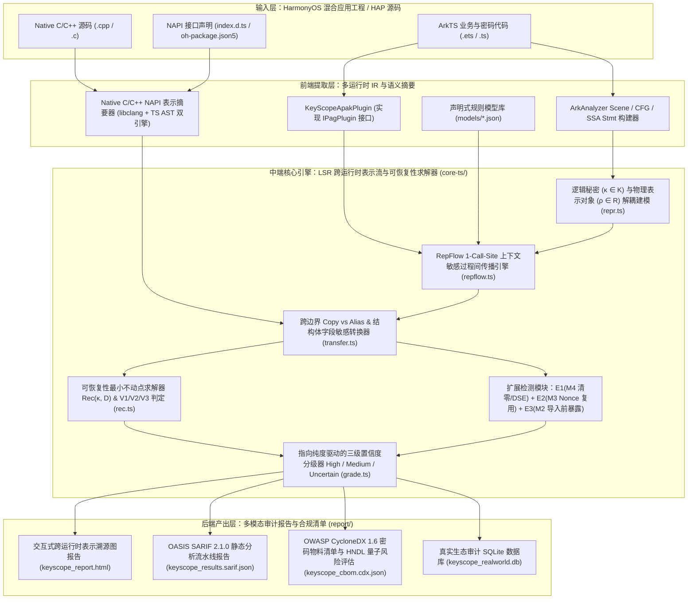
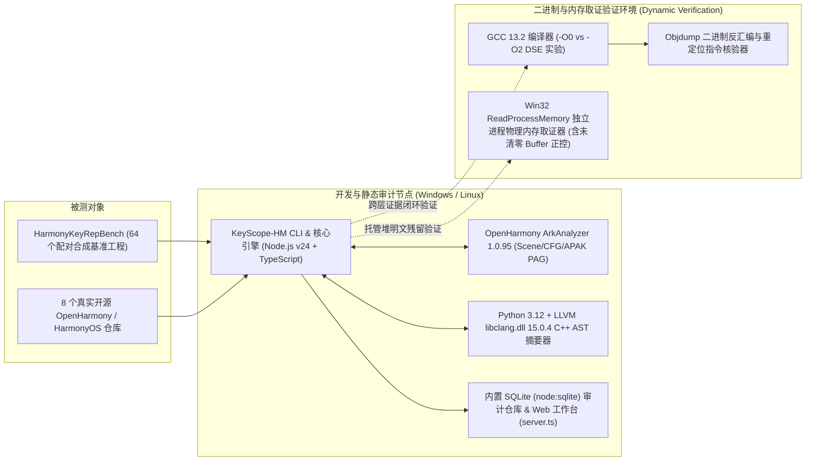

# 第五届“华秦杯”网络安全创新大赛创意作品赛 — 系统设计方案

- **作品名称**：鸿钥卫士（KeyScope-HM）——面向 HarmonyOS 混合应用的跨运行时密钥表示与暴露风险分析系统
- **英文简称**：KeyScope-HM v3.0
- **参赛赛道**：创意作品赛（密码安全与移动终端软件供应链安全方向）
- **核心引擎版本**：KeyScope-HM v3.0.0（基于 `arkanalyzer@1.0.95` + LSR 逻辑秘密与物理表示解耦模型）

---

## 1. 应用背景、问题定义与威胁模型

### 1.1 HarmonyOS 混合应用的跨运行时密码架构痛点

随着 HarmonyOS NEXT（纯血鸿蒙）在金融支付、政务办公、车联网与工业物联网等关键领域的规模化部署，商用鸿蒙应用普遍采用 **ArkTS 托管层 + Native C/C++ 原生层（NAPI 桥接）+ HUKS 通用密钥库硬件层** 的三层混合密码架构：

1. **ArkTS 托管层（Managed Runtime）**：通过 `@ohos.security.cryptoFramework` 执行对称/非对称加解密、密钥派生与协商；业务层常使用 `@ohos.util.Base64Helper`、`buffer`、`util.TextDecoder` 或自定义 `toHex()` 将密钥字节转换为不可变 `ArkTS String`，并经由 `@ohos.data.preferences`、`relationalStore`、`AppStorage` 或跨进程 `Want` / `rpc.MessageSequence` 传递。
2. **Native C/C++ 层（Native Runtime）**：通过 OpenSSL、openHiTLS 或自研国密（SM2/SM3/SM4）C/C++ 库生成或消费密钥，并借助 Node-API（`napi_get_arraybuffer_info`、`napi_create_buffer_copy`、`napi_create_external_arraybuffer`、`napi_create_string_utf8`）与 ArkTS 交互。
3. **HUKS 硬件层（TEE / StrongBox）**：通过 `@ohos.security.huks`（`generateKeyItem`、`importKeyItem`、`importWrappedKeyItem`、`initSession`、`finishSession`）将密钥受控于安全环境中，上层仅持有密钥别名（Key Alias / Handle）。

然而，现有的移动应用密码误用检测工具（如 CryptoGuard、CogniCrypt、iCryptoTracer、JScamd）均基于**同构单运行时假设**，无法应对 HarmonyOS 混合应用特有的三大结构性盲区：

- **盲区一：密钥材料（Key Material）与安全句柄/包装密文（Key Handle / Wrapped Key）混淆**。传统污点分析无法区分“向 `Preferences` 写入 HUKS 密钥别名 `'huks_sm4_key_alias'` 或经 HUKS 硬件密钥包装后的密文 `cipherKeyBlob`”（合规安全操作）与“向 `Preferences` 写入 `symKey.getEncoded().data` 的 Base64 编码字符串”（严重明文泄露），导致在正常商业应用上产生灾难性误报（实测二元污点基线 `B1` 在安全对照组上的误报率 A-FPR 高达 **75.00%**）。
- **盲区二：跨运行时 NAPI 边界的“拷贝（Copy）vs. 别名（Alias）”非对称生命周期失配**。当 C++ 侧使用 `napi_create_buffer_copy` 将密钥传回 ArkTS 时，底层发生了物理内存复制，此时即便 ArkTS 侧调用 `uint8Arr.fill(0)` 清零了托管缓冲区，若 C++ 原件未执行防编译器死存储消除（Dead Store Elimination, DSE）的 `memset_s` / `explicit_bzero`，或者在异常提前返回分支遗漏清零，Native 堆中仍会永久残留明文密钥。
- **盲区三：逻辑秘密身份（Logical Secret Identity）在汇合与包装解包链中的丢失**。若分析器将表示形式（`Raw`/`Enc`/`Wrapped`）直接作为变量属性的简单格合并，不仅会在条件分支汇合点产生不可能状态组合，更无法精确求解**“被软加密包装的密文 `Wrapped(κ_target)` 与其明文包装密钥 `κ_kek` 同时落入同一 `Preferences` 存储域”**的递归可恢复性风险。

### 1.2 威胁模型与五大暴露域划分

本系统针对四类现实攻击面建模（见 `models/policy_rules.json`），将运行时与外部环境划分为五个正交暴露域 $\mathcal{D}$：

| 暴露域符号 | 对应容器 $\mathsf{Container}$ | 现实攻击者能力与威胁面 |
| :--- | :--- | :--- |
| $D_{\text{mem}}$ | `ArkString`（不可变托管字符串堆） | 具备进程内存转储（Core Dump）、方舟堆快照提取（Heap Snapshot / DevTools 调试导出）或 root 取证能力的攻击者。由于 `ArkString` 不可原地覆写且受字符串驻留池与分代 GC 影响，密钥一旦进入 `ArkString` 即失去确定性清零能力。 |
| $D_{\text{pers}}$ | `Storage`（`Preferences` / `RDB` / `KVStore` / `FileIo` / `AppStorage`） | 具备应用备份提取（Backup Extractor）、越权文件读取或设备离线镜像取证能力的攻击者。 |
| $D_{\text{ipc}}$ | `IPC`（`Want` 参数 / `CommonEvent` / `rpc.MessageSequence`） | 同设备上的恶意应用或低权限协同组件，可监听公共事件或拦截未加密跨 Ability 传递的参数。 |
| $D_{\text{log}}$ | `Log`（`@ohos.hilog` / `console.*` / Native `OH_LOG_*` / `LOGI`） | 具备 ADB/HDC `hilog` 读取权限或崩溃日志收集权限的调试与第三方SDK组件。 |
| $D_{\text{safe}}$ | `HUKS` / 已受控清零的 `ArkBuffer` 与 `NativeHeap` | 受 TEE 硬件隔离保护或在使用完毕后已在所有路径上执行防 DSE 安全清零的受控边界。 |

---

## 2. 系统总体架构设计

### 2.1 软件与分析流水线总体架构

鸿钥卫士 KeyScope-HM 采用**“前端多源 IR 提取 $\to$ 中端 LSR 跨运行时不动点求解 $\to$ 后端多模态报告与合规产出”**的三层模块化架构：

### 2.2 硬件与运行环境拓扑架构

系统支持在开发者本地工作站、CI/CD 持续集成流水线节点以及安全审计服务器上无侵入运行，同时配备面向编译器优化验证与方舟/V8 堆取证验证的动态实验验证环境：

---

## 3. 核心理论创新：LSR（逻辑秘密与物理表示解耦）形式化模型

### 3.1 为什么必须解耦“逻辑秘密 $\kappa$”与“物理表示 $\rho$”？

一段逻辑秘密（例如一次会话中生成的 SM4 对称密钥 $\kappa_1$）在混合应用运行期会同时衍生出多个物理载体：Native 栈数组 `rawKey[16]`（$\rho_1$）、拷贝回 ArkTS 的 `Uint8Array`（$\rho_2$）、经 `Base64Helper.encodeToStringSync` 编码后的 `ArkTS String`（$\rho_3$）、或者经 HUKS 密钥包装后的密文 `cipherBlob`（$\rho_4$）。

KeyScope-HM 提出 **LSR（Logical-Secret / Representation）二元关系域**：

1. **逻辑秘密空间 $\mathcal{K}$**：每个密钥产生点（如 `symKeyGenerator.generateSymKey`、`huks.generateKeyItem`、Native `RAND_bytes` / `EVP_PKEY_derive`）创建唯一逻辑秘密身份 $\kappa \in \mathcal{K}$，并赋予静态安全等级：
   $$\mathsf{class}(\kappa) \in \{\mathsf{Session}, \mathsf{LongTerm}, \mathsf{HardwareBound}\}$$
2. **物理表示空间 $\mathcal{R}$**：每次分配、编码转换、NAPI 跨边界传输、包装或落盘操作创建或复用表示对象 $\rho \in \mathcal{R}$。每个表示对象 $\rho$ 在创建点即固定其不可变的形式与容器属性：
   $$\mathsf{form}(\rho) \in \{\mathsf{Raw}, \mathsf{Enc}, \mathsf{KeyObj}, \mathsf{Handle}, \mathsf{Wrapped}, \mathsf{OneWay}\}$$
   $$\mathsf{container}(\rho) \in \{\mathsf{NativeHeap}, \mathsf{ArkBuffer}, \mathsf{ArkString}, \mathsf{ArkKeyObj}, \mathsf{Storage}, \mathsf{IPC}, \mathsf{Log}, \mathsf{HUKS}\}$$
3. **单调事实关系库 $\mathcal{F}$ 与可恢复性半格合流（见 [`core-ts/repr.ts`](../core-ts/repr.ts)）**：
   - **表示形态半格（Form Recoverability Semilattice）**：为确保多路径数据流合流时严格满足交换律、结合律与幂等律（消除事实到达顺序依赖），定义全序格：
     $$\mathsf{OneWay} < \mathsf{Handle} < \mathsf{Wrapped} < \mathsf{KeyObj} < \mathsf{Raw} < \mathsf{Enc}$$
     当同一程序位置收到多个到达表示时，`Facts.addRepr` 执行单调并运算 $\mathsf{form}(\rho) \leftarrow \mathsf{form}_{\text{old}} \sqcup \mathsf{form}_{\text{new}}$。
   - $\mathsf{pts}(v, c) \subseteq \mathcal{H}$：在 1-call-site 上下文 $c$ 下，变量 $v$ 指向的抽象对象集合；
   - $\mathsf{fld}(o, f) \subseteq \mathcal{H}$：结构体/对象 $o$ 的字段 $f$ 指向的抽象对象集合；
   - $\mathsf{carries}(\rho) \subseteq \mathcal{K}$ 与 $\mathsf{directCarries}(\rho) \subseteq \mathcal{K}$：分别记录表示对象 $\rho$ 关联的全部逻辑秘密集合，以及**未经加密包装直接可恢复**的秘密子集（从而在受控包装密文 `Wrapped` 经二次 Base64/Hex 编码或落盘时保持 `form = Wrapped` 与 `wrapBy` 依赖，消除包装密文编码误报）；
   - $\mathsf{wrapBy}(\rho) \subseteq \mathcal{K}$：记录加密保护表示 $\rho$ 的包装密钥（KEK）集合（$\mathsf{form}(\rho) = \mathsf{Wrapped}$）；
   - $\mathsf{handleOf}(\rho) \subseteq \mathcal{K}$：表示 $\rho$ 仅作为逻辑秘密 $\kappa$ 的引用句柄或别名（$\mathsf{form}(\rho) = \mathsf{Handle}$），不含密钥字节；
   - $\mathsf{prov} \subseteq \mathcal{R} \times \mathsf{Op} \times \mathcal{R} \times \mathsf{Site}$：跨运行时表示演化溯源边集合。

### 3.2 核心表示转换传递函数（RepFlow Transfer Rules）

在过程间不动点迭代中（见 [`core-ts/rules/transfer.ts`](../core-ts/rules/transfer.ts) 与 [`core-ts/analysis/repflow.ts`](../core-ts/analysis/repflow.ts)），系统遵循以下关键语义公理：

1. **编码转换（Encode / Decode）**：调用 `Base64Helper.encodeToStringSync(src)`、`TextDecoder.decodeToString(src)`、自定义 `toHex(src)` 或 Native `napi_create_string_utf8` 时，创建新表示 $\rho_{\text{new}}$，设置 $\mathsf{form}(\rho_{\text{new}})=\mathsf{Enc}, \mathsf{container}(\rho_{\text{new}})=\mathsf{ArkString}$，且继承所有秘密身份：
   $$\mathsf{carries}(\rho_{\text{new}}) \supseteq \bigcup_{\rho_s \in \mathsf{pts}(\text{src}, c)} \mathsf{carries}(\rho_s)$$
2. **NAPI 拷贝 vs. 别名语义（Copy vs. Alias）**：
   - **拷贝（Copy）**：`napi_create_buffer_copy` 或 `napi_get_value_string_utf8` 创建独立的表示节点 $\rho_{\text{copy}} \neq \rho_{\text{src}}$，仅继承 $\mathsf{carries}(\rho_{\text{copy}}) \supseteq \mathsf{carries}(\rho_{\text{src}})$，但**不共享清零状态** $\mathsf{zeroizedMust}$；因此对 $\rho_{\text{copy}}$ 调用 `.fill(0)` 不会把 $\rho_{\text{src}}$ 标记为已清零。
   - **别名（Alias）**：`napi_get_arraybuffer_info`、`napi_get_typedarray_info` 或 `napi_create_external_arraybuffer` 复用同一底层物理缓冲区表示（或建立双向 `alias` 等价类），原位清零同步生效。
3. **受控密钥包装（Key Wrapping）**：调用 `cipher.doFinal(targetKeyBytes)`（其中 `cipher` 由包装密钥 $\kappa_{\text{kek}}$ 初始化）生成 $\rho_{\text{wrap}}$，设置 $\mathsf{form}(\rho_{\text{wrap}})=\mathsf{Wrapped}$，此时**清空直接携带关系** $\mathsf{carries}(\rho_{\text{wrap}}) = \emptyset$，并将包装依赖记录至 $\mathsf{wrapBy}(\rho_{\text{wrap}}) \supseteq \{(\kappa_t, \kappa_{\text{kek}})\}$。
4. **单向摘要截断（One-Way Hash）**：调用 `md.digest()`（SHA-256 / SM3）或 `hmac.doFinal()` 输出 $\rho_{\text{hash}}$，设置 $\mathsf{form}(\rho_{\text{hash}})=\mathsf{OneWay}, \mathsf{carries}(\rho_{\text{hash}})=\emptyset$，从根源上消除对公开指纹或消息摘要的误报。

### 3.3 秘密可恢复性最小不动点 $\mathrm{Rec}(\kappa, D)$ 与违规公理 `V1`–`V3`

在 RepFlow 收敛后，系统在有限域 $\mathcal{K} \times \mathcal{D}$ 上通过单调递推求解**秘密 $\kappa$ 在暴露域 $D$ 中的可恢复性谓词 $\mathrm{Rec}(\kappa, D)$**（见 [`core-ts/rec.ts`](../core-ts/rec.ts)）：

- **基例（直接明文或可逆编码暴露）**：若存在表示 $\rho \in \mathcal{R}$ 位于暴露域 $D$（即 $\mathsf{domain}(\mathsf{container}(\rho)) = D$），且满足：
  $$\kappa \in \mathsf{carries}(\rho) \;\land\; \mathsf{form}(\rho) \in \{\mathsf{Raw}, \mathsf{Enc}, \mathsf{KeyObj}\}$$
  则 $\mathrm{Rec}(\kappa, D) = \mathsf{true}$。
- **归纳步（软包装密钥同域共置可逆恢复）**：若存在包装密文表示 $\rho \in \mathcal{R}$ 位于暴露域 $D$（$\mathsf{form}(\rho) = \mathsf{Wrapped}$），满足 $(\kappa, \kappa_{\text{kek}}) \in \mathsf{wrapBy}(\rho)$，且包装密钥 $\kappa_{\text{kek}}$ 在同一暴露域 $D$（或内存域 $D_{\text{mem}}$）中可恢复：
  $$(\kappa, \kappa_{\text{kek}}) \in \mathsf{wrapBy}(\rho) \;\land\; \mathrm{Rec}(\kappa_{\text{kek}}, D) = \mathsf{true} \implies \mathrm{Rec}(\kappa, D) = \mathsf{true}$$
- **安全不变量**：若 $\mathsf{form}(\rho) \in \{\mathsf{Handle}, \mathsf{OneWay}\}$，或 $(\kappa, \kappa_{\text{huks}}) \in \mathsf{wrapBy}(\rho)$ 且 $\mathsf{class}(\kappa_{\text{huks}}) = \mathsf{HardwareBound}$（硬件根密钥不可导出，$\mathrm{Rec}(\kappa_{\text{huks}}, D) = \mathsf{false}$），则不会触发 $\mathrm{Rec}(\kappa, D)$。

基于 $\mathrm{Rec}(\kappa, D)$，系统定义三条核心违规判定公理与三项扩展检测能力：

| 规则编号 | 名称 | 形式化触发条件 | 关联 CWE |
| :--- | :--- | :--- | :--- |
| **V1** | 不可变托管字符串驻留风险 | $\mathrm{Rec}(\kappa, D_{\text{mem}}) = \mathsf{true} \;\land\; \mathsf{class}(\kappa) \in \{\mathsf{Session}, \mathsf{LongTerm}\}$ | CWE-316 / CWE-226 |
| **V2** | 非受信持久化与 IPC 边界暴露 | $(\mathrm{Rec}(\kappa, D_{\text{pers}}) \lor \mathrm{Rec}(\kappa, D_{\text{ipc}})) \;\land\; \mathsf{class}(\kappa) \neq \mathsf{HardwareBound}$ | CWE-312 / CWE-319 |
| **V3** | 诊断日志通道明文或可逆编码泄漏 | $\mathrm{Rec}(\kappa, D_{\text{log}}) = \mathsf{true}$ | CWE-532 |
| **E1 (M4)** | 缓冲区路径必达清零缺失与编译器 DSE | $\exists \rho \in \mathcal{R}: \mathsf{form}(\rho)=\mathsf{Raw} \land \mathsf{carries}(\rho)\neq\emptyset \land (\rho \notin \mathsf{zeroizedMust} \lor \rho \in \mathsf{plainMemset})$ | CWE-14 / CWE-226 |
| **E2 (M3)** | 认证加密（GCM/CCM/CTR）静态或复用 Nonce | $\mathsf{Cipher.init}(\text{AES/SM4-GCM}, \kappa, \text{iv})$ 中 $\text{iv}$ 为全零/常量数组或跨次加密重复使用 | CWE-323 / CWE-329 |
| **E3 (M2)** | HUKS 外部密钥明文导入前暴露链 | $\mathsf{huks.importKeyItem}(\text{alias}, \rho_{\text{in}})$ 的上游溯源链中存在 `ArkString` 或非受控副本 | CWE-312 / CWE-532 |

---

## 4. 核心工程模块实现细节

### 4.1 基于 ArkAnalyzer 1.0.95 的过程间与上下文敏感分析 (`core-ts/analysis/repflow.ts`)

1. **真实 ArkIR 构建**：调用 `SceneConfig.buildFromProjectDir` 与 `Scene.buildSceneFromProjectDir` 将 `.ets`/`.ts` 源码解析为三地址码 `Cfg` 与 SSA 风格 `Stmt`（`ArkAssignStmt`、`ArkInvokeStmt`、`ArkReturnStmt`、`ArkInstanceFieldRef`、`ArkPhiExpr`），并实现 `KeyScopeApakPlugin implements IPagPlugin` 对接 APAK 指针分析框架。
2. **1-Call-Site 上下文敏感堆克隆**：当业务代码调用通用编码辅助函数（如 `toHex(bytes)`、`bytesToHex(buf)`）时，引擎以调用点行号构造上下文标识 `ctx = CALL@File.ets:Line`，将形参绑定在 `${methodKey}@${ctx}#param0`，返回值绑定在 `${methodKey}@${ctx}#ret`。这确保了当 `toHex(publicIv)` 与 `toHex(secretKey)` 先后调用同一个辅助函数时，公开 IV 的表示绝不会污染秘密密钥的表示（在 `HarmonyKeyRepBench` 的 `F5` 家族上实现 **4/4 零误报通过**，而去掉上下文敏感的 `-Ctx` 消融变体在 `F5` 上为 0/4）。
3. **结构体字段敏感与 JSON 序列化传播**：通过 `Facts.addFld(baseReprId, fieldName, rhsPts)` 精确跟踪 `bundle.sessionKeyHex` 与 `bundle.publicIvHex` 等同对象不同字段；当调用 `JSON.stringify(bundle)` 时，自动聚合该对象所有传递字段的表示集合。

### 4.2 跨语言 NAPI 语义桥接器 (`native-py/napi_summarizer.py` & `core-ts/bridge/napi_bridge.ts`)

系统提供 Python `libclang` AST 分析器与 TypeScript 原生 C/C++ 解析器双引擎协同的 NAPI 摘要器：
1. **自动提取导出映射表**：识别 `napi_property_descriptor desc[] = {{"deriveKeyHex", nullptr, DeriveKeyHex, ...}}` 与 `DECLARE_NAPI_FUNCTION` 宏，并与 `index.d.ts` 中的 TypeScript 声明自动对齐。
2. **入参、秘密生成与返回值语义分类**：识别 `napi_get_arraybuffer_info`（`alias`）、`napi_get_value_string_utf8`（`copy`）、`RAND_bytes` / `EVP_PKEY_derive` / `ECDH_compute_key` / `HITLS_CRYPT_DeriveKey`（Native 秘密产生点）、`napi_create_string_utf8`（`encode` -> `ArkString`）、`napi_create_buffer_copy`（`copy` -> `ArkBuffer`）与 `napi_create_external_arraybuffer`（`alias` -> `ArkBuffer`）。
3. **C/C++ 退出路径必达清零与 DSE 检查**：静态检查每个分配或承载密钥字节的 Native 缓冲区在所有返回分支（含 `if (err != 0) return nullptr;` 异常早退分支）之前是否调用了安全清零原语（`memset_s`、`explicit_bzero`、`OPENSSL_cleanse`），并标记易被 `-O2` 编译器消除的普通 `memset`。

---

## 5. 系统主要技术指标与评测达成情况总结

本系统各项设计指标均已通过实测验证（详见《02_系统测试方案》）：

| 指标维度 | 目标技术指标 | 实测达成结果 | 数据来源与验证脚本 |
| :--- | :--- | :--- | :--- |
| **配对基准综合 F1** | $\ge 90.0\%$ | **100.00%**（Precision=100%, Recall=100%） | [`eval/benchmark_results.json`](../eval/benchmark_results.json) |
| **安全对照组误报率 (A-FPR)** | $\le 10.0\%$ | **0.00%**（32 个安全负样本零误报，对比 B1 污点基线 75.00%） | [`eval/run_benchmark_eval.ts`](../eval/run_benchmark_eval.ts) |
| **单工程分析中位耗时** | $\le 5000\text{ ms}$ | 合成基准 **108.25 ms**；真实仓库单仓 **170–1140 ms** | [`eval/benchmark_results.json`](../eval/benchmark_results.json) |
| **独立反例与外部泛化测试** | 5 大审查反例 + 留出集全通过 | `wrapped_encoded`、`merge_order`、`native_derive_output`、`file_name_dependency`、`pos_control_heap` 及外部留出样例 **100% 通过 (Gate G5)** | [`eval/run_all_tests.ts`](../eval/run_all_tests.ts) |
| **真实开源仓库静态审计** | $\ge 8$ 个真实仓库 | 扫描 **8 个**真实 OpenHarmony/HarmonyOS 仓库，检出 **19 条带真实源码上下文片段 (`sourceSnippet`) 的静态告警**（阴性对照 `harmonyos_preferences` 0 告警，完全与文件名无关） | [`realworld/realworld_summary.json`](../realworld/realworld_summary.json) |
| **二进制与物理内存取证验证** | 含正控与负控的物理证据 | GCC 13.2 `-O2` 下普通 `memset` 清零指令保留率 **0%**；Win32 `ReadProcessMemory` 四组扫描：**基线 0/10、未清零 `Uint8Array` 正控 10/10 (100%)、`String` 风险组 10/10 (100%)、`.fill(0)` 安全组 0/10 (0%)** | [`dynamic/run_dynamic_experiments.ts`](../dynamic/run_dynamic_experiments.ts) |
| **交互式编译器工作台与报告** | 编译器 IR/AST 工作台 + 多模态报告 | 提供三栏同步对照 Web 工作台（`npm run ui` / `keyscope_report.html`）、OASIS SARIF 2.1.0、OWASP CycloneDX 1.6 CBOM | [`core-ts/server.ts`](../core-ts/server.ts)、[`report/report_generator.ts`](../report/report_generator.ts) |
