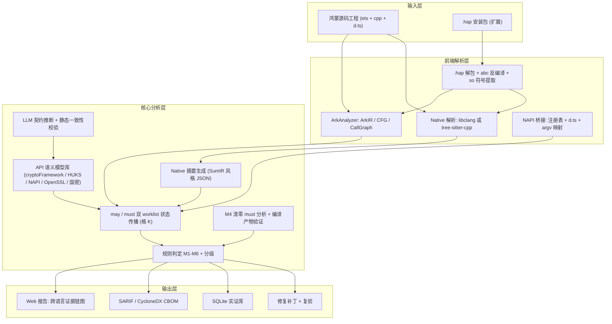
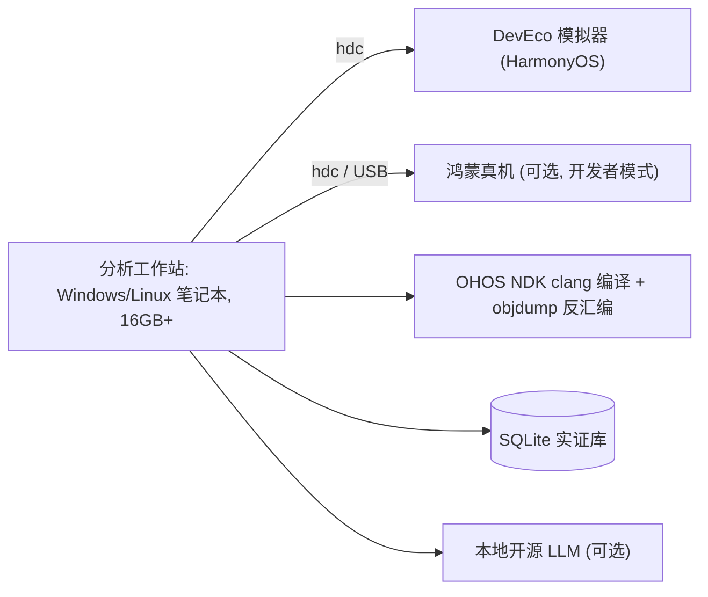

# 鸿钥卫士 KeyScope-HM v2.0 —— 完整开发与参赛工程总文档（修订版）

**全称**：鸿钥卫士 KeyScope-HM —— 面向 HarmonyOS ArkTS–Native 混合应用的密钥生命周期误用检测与密码物料体检系统
**赛道**：2026 第五届"华秦杯"网络安全创新大赛 · 创意作品赛
**对应作品方向**：密码应用、密钥管理、密码算法实现、国密算法、后量子密码（迁移评估）

> [!IMPORTANT]
> **v2 相对 v1 的核心修订**
> 1. 修正状态模型数学错误（E 为幂集；O、L 改为集合维度；删除无意义的统计量）；给出正确的格高度与终止性论证。
> 2. 区分"句柄"与"密钥"：别名不再被标为 TEE_Isolated，而是引用其所指密钥的状态。
> 3. 用 **may/must 双分析**来定义"明确风险 / 潜在风险"，不再凭感觉分级。
> 4. M1 覆盖"hex/Base64 编码后字符串化"与**纯 ArkTS 路径**（真实项目中更常见）。
> 5. 新增 **M6：密码物料清单（CBOM）+ 抗量子迁移就绪度评估**，对接作品方向首项"后量子密码"。
> 6. 加入明确的威胁模型；补齐 Preferences 沙箱 / 加密分区等反驳点的回应。
> 7. 引擎必须基于 ArkAnalyzer IR + worklist 不动点迭代，正则只作为 Baseline A。
> 8. 验证体系加入：人工双标注、真实漏洞负责任披露、编译产物反汇编、堆快照对照组。
> 9. 所有引用标注【已核实】/【待核实】，所有实验数字一律"实测后填入"。

---

## 目录
- 第 0 章 一句话定位与作品形态
- 第 1 章 立项意义
- 第 2 章 相关工作与边界
- 第 3 章 威胁模型与问题定义
- 第 4 章 核心技术设计
- 第 5 章 系统架构与模块设计
- 第 6 章 技术选型与工程结构
- 第 7 章 开发路线与里程碑
- 第 8 章 系统测试与验证方案
- 第 9 章 决赛演示与答辩设计
- 第 10 章 专家提问预案
- 第 11 章 风险清单与对策
- 第 12 章 提交材料对照清单
- 附录 A 核心引擎骨架代码
- 附录 B 引用核实清单

---

## 第 0 章 一句话定位与作品形态

**一句话**：传统污点分析只回答"数据有没有流过去"，KeyScope-HM 回答"**一个密钥流过 ArkTS / NAPI / Native / HUKS 边界之后，它的密码学保护条件是否仍然成立**"，并给出可复现的运行时证据和修复补丁。

**作品形态（三件交付物）**：

| 交付物 | 形式 | 作用 |
|---|---|---|
| ① 分析引擎 | CLI + Web 报告；输入鸿蒙源码工程（主线）或 .hap（扩展） | 检出 M1–M6 并给出跨语言证据链 |
| ② HarmonyCryptoBench | 开源成对差分基准（安全版 / 风险版） | 可复现评测，作为社区贡献 |
| ③ 实证包 | 真实项目扫描库 + 已披露问题清单 + 堆快照 / 反汇编证据 | 证明"发现过真问题" |
| （决赛加分）④ IDE 集成 | DevEco Studio / VS Code 插件或 CodeLinter 规则 | 演示"标红 → 一键修复 → 复验" |

---

## 第 1 章 立项意义

### 1.1 产业背景

- **鸿蒙原生应用进入规模化迁移期**：HarmonyOS NEXT 之后不再兼容 APK，金融、政企、主流 App 需要用 ArkTS 重写。大量既有 C/C++ 密码代码（OpenSSL、国密库、自研 SDK）通过 NAPI 复用，形成"**ArkTS 业务层 + NAPI 桥 + Native 密码库 + HUKS 系统密钥库**"的四层混合模型。【终端装机量、HDC 2026 数据：待核实，必须附官方原文链接，否则删除】
- **学术界的分析基础设施在 2025–2026 年才成型**：
  - ArkAnalyzer：OpenHarmony 官方 ArkTS 静态分析框架，提供 ArkIR、CFG、调用图。【已核实存在，版本需注明】
  - HarmoBridge（ASE 2025）：提出 SumIR，把 Native 代码的数据流摘要翻译成 ArkIR 兼容的函数体，打通 ArkTS↔C/C++ 跨语言数据流，并发布 CrossFlowBench 基准。【已核实】
  - HapCheck（ICSE 2026 SEIP，北航 + 华为）：基于 DSL 的 OpenHarmony 静态缺陷检测框架，实际部署中发现大量缺陷。【已核实；具体数字引用前再对照原文】
- **结论**：跨语言数据流这条"路"刚修通，但还没有工作专门回答**密码学层面**的问题：路上运的是密钥、句柄还是公开参数？过边界之后保护状态降级了没有？

### 1.2 为什么系统层和编译器解决不了（答辩核心论点）

1. **API 本身合法**：`napi_create_string_utf8`、`huks.importKeyItem`、`preferences.put` 都是正常业务接口，不能直接封禁。
2. **底层没有密码语义**：运行时只看到 `const char*` 或 `Uint8Array`，分不清里面是业务文本、HUKS 别名、公开盐值还是 SM4 裸密钥。
3. **只能靠上下文程序分析**：判断是否误用，必须追踪数据的来源、角色、保护状态和去向，而且要跨三种语言和运行时。这正是本作品要做的。

### 1.3 六类问题（M1–M6）及依据

| 编号 | 问题 | 标准依据 | 本质 |
|---|---|---|---|
| **M1（主攻）** | 密钥材料进入不可擦除的托管字符串（Native 经 NAPI 转出，或 ArkTS 内部 Base64 / hex / TextDecoder 字符串化） | CWE-316、CWE-226 | 丧失即时擦除能力，明文残留时间不可控 |
| **M2** | 明文导入 HUKS 前的暴露链（日志、多次拷贝、跨层传递） | CWE-532、CWE-312 | 合法 API 之前的不必要暴露 |
| **M3** | AEAD / CTR 模式下 IV / Nonce 复用、公开参数与密钥角色混淆、硬编码密钥 | CWE-323、CWE-321、CWE-329 | GCM Nonce 复用会直接破坏机密性和认证性 |
| **M4** | Native 密钥缓冲区未清零：异常分支漏清理，或普通 `memset` 被死存储消除 | CWE-14、CWE-226 | 编译器优化导致清零代码"消失" |
| **M5（主攻）** | 临时 / 会话密钥被明文持久化或经 IPC 发出 | CWE-312、CWE-927 | **破坏前向安全性**；扩大暴露面 |
| **M6（新增）** | 密码物料清单 + 弱算法 + 抗量子迁移就绪度 | NIST IR 8547（量子脆弱算法迁移时间表）【待核实条目号】、GB/T 39786-2021 | 先存储、后解密（HNDL）风险；密码敏捷性不足 |

> [!NOTE]
> 引用往届获奖作品（如哈工大安卓密钥泄露平台）只能说明"评委认可这一方向"，**不能当作痛点证据**，应放在"竞品与差异"部分。

### 1.4 价值主张

- **对开发者**：在 IDE / CI 阶段发现"API 调用都对，组合起来却错了"的密钥误用。
- **对华为生态**：为鸿蒙应用上架审核、三方库（ohpm）治理提供密码专项检查能力。
- **对合规**：输出 CBOM，辅助密评（GB/T 39786）与抗量子迁移规划。
- **对学术**：提出跨运行时的密钥状态格模型，并开源基准。

---

## 第 2 章 相关工作与边界

| 工作 | 已解决的问题 | 本作品的关系与新增点 |
|---|---|---|
| ArkAnalyzer | ArkTS → ArkIR、CFG、调用图 | **直接复用**为前端 |
| HarmoBridge / SumIR + CrossFlowBench | 跨语言数据流恢复 | 借鉴"Native 摘要注入 ArkIR"的思路（开源则直接复用）；用 CrossFlowBench 验证跨语言连通性；**不主张跨语言数据流是首创** |
| HapCheck | DSL 驱动的通用缺陷检测 | 关注的是通用缺陷；本作品专攻**密码对象的多维状态**；可将部分规则导出为 HapCheck 风格 DSL 以示兼容 |
| ArkTaint 等污点工具 | 二元 source→sink 污点 | 作为 **Baseline B** 的思想来源；本作品证明多维状态能降低误报 |
| CryptoGuard、CogniCrypt / CrySL、CryptoAPI-Bench（Java / Android） | Java 密码 API 误用检测与基准 | 借鉴规则分类和基准设计；**鸿蒙 ArkTS + 跨语言场景此前没有对应工具** |
| arkdecompiler 等 .abc 反编译器 | 字节码恢复 | 作为 .hap 扩展的前置组件，并对恢复缺口做不确定性标注 |
| 往届安卓密钥泄露 + 大模型智能体作品 | 安卓生态硬编码密钥泄露与影响评估 | 本作品聚焦**鸿蒙跨运行时生命周期**；LLM 只做契约推断，**不参与判定** |

**三项原创贡献（收紧表述）**：
- **贡献 A**：跨运行时**密码对象状态格** K，区分密钥材料、句柄、公开参数，以及来源、保护、生命周期、暴露范围。
- **贡献 B**：基于 may/must 双分析的**跨边界状态传播与分级判定算法**，把"明确风险 / 潜在风险 / 分析不确定"形式化。
- **贡献 C**：**HarmonyCryptoBench** 成对差分基准 + 真实生态实证 + 运行时（堆快照）与编译产物（反汇编）双重证据。

---

## 第 3 章 威胁模型与问题定义

### 3.1 攻击者能力（按场景）

| 场景 | 攻击者能力 | 对应问题 |
|---|---|---|
| T1 内存获取 | 能获取应用进程内存快照：调试接口、root / 越狱设备、崩溃转储、同进程恶意 SDK | M1、M4 |
| T2 持久化介质 | 能读取应用沙箱文件：设备丢失后取证、备份导出、root | M5-Storage、M2 |
| T3 IPC 观察 | 能接收或观察跨应用 Want 参数（隐式启动、被劫持的目标组件） | M5-IPC |
| T4 被动记录 | 长期记录密文流量，等待未来的量子计算能力 | M6（HNDL） |
| T5 日志 | 能读取 hilog / 上传的崩溃日志 | M2 |

### 3.2 不在范围内

- 攻破 TEE / HUKS 本身；内核漏洞；侧信道（功耗、缓存计时）。
- 判断"业务逻辑是否需要这个密钥"这类需求层问题。

### 3.3 关键反驳点的诚实回应

- **"Preferences 在沙箱里，还有 EL2 文件加密。"** 沙箱和分区加密防的是其他应用和关机状态。但①**会话密钥一旦落盘就破坏前向安全性**：以后只要设备被攻破一次，历史会话就能被解密，这是密码学层面的问题，与沙箱无关；②root、备份、取证场景依然成立。因此 M5-Storage 默认定为"潜在风险（纵深防御）"；若同时满足"会话密钥 + 持久化 + 无包装"，才升级为"明确风险"。
- **"ArkTS String 迟早会被 GC 回收。"** 回收≠清零。回收后内存何时被覆盖不确定，移动式 GC 还可能留下副本。M1 说的是"**失去即时、确定擦除能力**"，用堆快照做实证（见 8.5）。
- **"Uint8Array 也不一定安全。"** 承认。安全版要求"受控缓冲区 + 用后 `fill(0)` + Native 侧单独清零"，并在报告中列出残余风险（框架内部副本）。

### 3.4 形式化问题定义

给定混合工程 𝒫，对每个程序点 n 和抽象内存位置 v 计算 K_n(v)，判定谓词：

- M1：R ⊒ KeyMaterial ∧ ArkTS_String ∈ E
- M5：R ⊒ KeyMaterial ∧ P ⊒ Controlled_Buf ∧ (L ∩ {Ephemeral, Session} ≠ ∅) ∧ (E ∩ {Storage, IPC} ≠ ∅)
- 分级：must 分析下谓词成立 → Confirmed；仅 may 分析下成立 → Potential；路径经过未建模的调用或反编译缺口 → Uncertain。

---

## 第 4 章 核心技术设计

### 4.1 密码对象状态格 K（修正版）

对每个抽象位置 v 维护：

$$K(v) = (R,\ O,\ P,\ L,\ E)\quad\text{以及句柄引用}\ \mathit{ref}(v)$$

| 维度 | 取值域 | 偏序 / 合并 | 合并的含义 |
|---|---|---|---|
| R 角色 | {PublicParam ⊑ KeyHandle ⊑ KeyMaterial} | 全序，取最大值 | 只要可能是密钥材料，就按密钥材料对待 |
| O 来源 | 𝒫({HUKS_Gen, Derived, Imported, Hardcoded}) | 集合，取并集 | **不强行规定来源的危险排序**，保留全部可能来源 |
| P 保护 | {TEE_Isolated ⊑ Wrapped ⊑ Controlled_Buf ⊑ Unmanaged_Plain} | 全序，取最大值 | 取最差保护状态 |
| L 生命周期 | 𝒫({Ephemeral, Session, Persistent}) | 集合，取并集 | 保留全部可能生命周期 |
| E 暴露范围 | 𝒫({NativeMem, ArkTS_Buf, ArkTS_String, Storage, IPC, Log}) | 集合，取并集 | 累积所有触达过的边界 |

- **格高度** h = 2 + 4 + 3 + 3 + 6 = **18**。每个位置的状态最多上升 18 次，worklist 迭代复杂度为 O(h·|N|·|V|)，**保证终止**。这句论证比报"状态空间多少种"更有说服力。
- **句柄与密钥分离**：`huks.generateKeyItem(alias, …)` 产生两个对象：密钥对象 k*，K(k*) = (KeyMaterial, {HUKS_Gen}, TEE_Isolated, {Persistent}, ∅)；别名对象，K(alias) = (KeyHandle, …, P = 无关, …)，且 ref(alias) = k*。别名写进 String 或 Preferences，不会触发 M1 / M5。只有当代码通过导出接口（如 `exportKeyItem`）取出密钥材料时，才产生新的 KeyMaterial 对象。
- **M4 不放进 K**：清零属于"所有路径都必须做到"的性质，单独用 **must 分析**（交汇处取交集）跟踪 Zeroized(v)。

### 4.2 转移函数（关键规则）

| 语句模式 | 状态更新 |
|---|---|
| `cryptoFramework.createSymKeyGenerator(...).generateSymKey()` | 新建 KeyMaterial，O = {Derived}，P = Controlled_Buf（DataBlob），L 由使用上下文推断 |
| `key.getEncoded()` → DataBlob.data | 继承密钥状态，E ∪ {ArkTS_Buf} |
| `Base64Helper.encodeToString*`、`TextDecoder.decode`、自定义 `toHex`、`String.fromCharCode`、模板字符串拼接 | **P ← Unmanaged_Plain，E ∪ {ArkTS_String}** → M1（纯 ArkTS 路径） |
| Native 中 `napi_create_string_utf8 / latin1 / utf16(buf或hex(buf))` | 同上 → M1（跨语言路径） |
| `napi_create_buffer_copy` / `napi_create_arraybuffer` + memcpy / `napi_create_external_arraybuffer` | P 保持 Controlled_Buf，E ∪ {ArkTS_Buf}；**副本与原缓冲区分别跟踪清零** |
| `RAND_bytes`、`HKDF`、`ECDH_compute_key`、`EVP_PKEY_derive`、国密派生函数（写入 buf） | 新建 KeyMaterial，O = {Derived}，P = Controlled_Buf，E = {NativeMem} |
| 字面量数组 / 字符串直接作为 key 参数 | O ∪ {Hardcoded} → M3-硬编码 |
| `preferences.put`、`fs.write`、`relationalStore.insert`、KV store | E ∪ {Storage} → 检查 M5 |
| `want.parameters[...]`、`startAbility(want)`、`rpc.MessageSequence.write*` | E ∪ {IPC}；隐式 Want 加重等级 → 检查 M5 |
| `hilog.*`、`console.*` | E ∪ {Log} → M2 / 通用泄露 |
| `huks.wrapKey` / 自定义包装函数（由契约给出） | P ← Wrapped |
| `huks.importKeyItem(alias, {inData: x})` | 检查 x 的历史 E：若含 Log / Storage / ArkTS_String 或拷贝次数 > 阈值 → M2；**导入动作本身不报** |
| `cipher.init(mode, key, ivParams)`，模式为 GCM / CCM / CTR | 记录 (key 对象, iv 对象) 二元组；同一 key 下 iv 来自 Hardcoded、类字段且两次 init 之间未重新生成，或同一 iv 对象出现在两次 init → M3 |
| `memset_s` / `explicit_bzero` / `OPENSSL_cleanse` / volatile 清零循环 | Zeroized(buf) ← true；**普通 `memset` 标为"待编译验证"** |

### 4.3 跨语言桥接

1. **注册表解析**：从 C++ 中提取 `napi_property_descriptor` 数组和 `napi_module_register` / `napi_define_properties`，得到 JS 名 → C++ 函数。
2. **类型声明对齐**：解析 `index.d.ts`、`oh-package.json5`，把 ArkTS 侧的 `import xxx from 'libxxx.so'` 调用点和 C++ 函数对上。
3. **参数映射**：`napi_get_cb_info` 的 argv[i] ↔ ArkTS 实参 i；`napi_get_arraybuffer_info`、`napi_get_value_string_utf8` 等决定入参在 Native 侧的形态。
4. **Native 摘要**：每个 NAPI 函数生成一份摘要（SumIR 风格 JSON），包含入参到返回值的状态变换、清零行为、内部新建的密码对象。ArkTS 侧分析遇到 Native 调用时**直接套用摘要**，不再展开分析。
5. **缺口处理**：函数指针、动态注册、宏展开失败时，生成"未知摘要"：返回值的 K 取保守的 ⊤，**并标为 Uncertain**。

### 4.4 大模型契约推断（辅助，不参与判定）

- **输入**：没有内置模型的自定义函数（如 `deriveSessionKey`、`MyCrypto::wrap`）的签名 + 函数体切片。
- **输出**：严格 JSON 契约，例如 `{param_roles:[KeyMaterial,PublicParam], returns:{role:KeyMaterial, protection:Wrapped}, zeroizes:[0]}`。
- **三道防线**：①JSON Schema 校验；②**静态一致性校验**（例如声称"清零了参数 0"，函数体里必须真的有清零调用，否则拒收）；③以低置信度进入分析，由此产生的告警最高只能标为 Potential。
- **可关闭**：消融实验里专门报告"有 / 无 LLM"的召回差异，证明它只是扩展覆盖面。可用本地开源模型，避免把源码上传到外部服务。

### 4.5 M6：CBOM 与抗量子迁移评估

- **资产提取**：`createCipher('SM4_128|GCM|NoPadding')`、`createAsyKeyGenerator('RSA2048')`、`createMd('SHA1')`，以及 Native 侧的 EVP 名称和国密函数，解析出算法、模式、密钥长度、调用位置、密钥对象状态。
- **输出格式**：CycloneDX 1.6 CBOM（该版本支持 cryptographic-asset 组件类型）。【已知；落地前核对字段】
- **评估维度**：
  - 弱算法：MD5、SHA1、DES / 3DES、ECB、RSA < 2048 等。
  - 量子脆弱：RSA、ECC、SM2、(EC)DH 用于密钥交换或长期签名。
  - **HNDL 暴露分**：量子脆弱的密钥协商 × 数据保密期（是否持久化或传输长期敏感数据）。
  - **密码敏捷性**：算法字符串硬编码的分散程度、是否集中配置、序列化格式是否写死密钥长度。
- **说明**：当前 cryptoFramework 标准算法列表中**尚未见到** ML-KEM / ML-DSA【待在最新 API 文档核实】。因此 M6 的定位是"**迁移就绪度体检**"，而不是"检测是否已使用后量子算法"。迁移建议可指向 Native 侧集成（如 liboqs / OpenSSL 3.5+）作为过渡方案。

### 4.6 风险分级与报告

| 等级 | 判定 | 可视化 |
|---|---|---|
| Confirmed_Risk | must 分析下谓词成立，且路径上没有未知摘要 | 红色实线 |
| Potential_Risk | 仅 may 分析成立；或依赖 LLM 契约；或属于纵深防御类（M5-Storage 沙箱内） | 黄色 |
| Analysis_Uncertainty | 路径经过未知摘要或反编译缺口 | 橙色虚线 + 缺口位置 |

每条发现附带：跨语言调用链切片（ArkTS 行号 ↔ C++ 行号）、每一跳的 K 快照 K₀→K₁→…、CWE 编号、修复建议、可选的自动补丁。


---

## 第 5 章 系统架构与模块设计

### 5.1 软件架构



### 5.2 "硬件框图"（文档模板要求，纯软件作品写部署与验证环境）



### 5.3 软件流程

1. 加载工程 → ArkAnalyzer 构建 Scene → 获取全部方法的 ArkIR / CFG。
2. 对 cpp/ 下所有 NAPI 导出函数做过程内分析 → 生成摘要；无法分析的函数生成"未知摘要"。
3. 扫描未建模的自定义函数 → LLM 推断契约 → 校验后并入模型库。
4. 从入口（Ability 生命周期、UI 回调、导出函数）出发，构建过程间 worklist，并行运行 may / must 两套分析直到不动点。
5. 在每个 sink 点与 `cipher.init` 点求值 M1–M5 谓词并分级；M4 结合编译产物验证；M6 汇总资产。
6. 输出报告和补丁；补丁应用后自动复验。

---

## 第 6 章 技术选型与工程结构

| 模块 | 选型 | 理由 |
|---|---|---|
| ArkTS 分析核心 | **TypeScript + ArkAnalyzer**（npm / Gitee 官方仓） | 和 ArkIR 同一技术栈，免去序列化损失；专家看代码时最直接 |
| Native 摘要 | Python + libclang（主），tree-sitter-cpp（兜底，用于没有编译数据库的工程） | libclang 能拿到类型和宏展开 |
| .hap 扩展 | Python：zipfile + arkdecompiler / ark_disasm + pyelftools | 提取 abc 和 so 符号 |
| LLM | 本地 Qwen 系列等开源模型 / 可配置 API | 可离线，保护源码 |
| 存储 | SQLite（演示），表结构兼容 PostgreSQL | 轻量 |
| 报告 | SARIF 2.1.0 + 静态 HTML（Cytoscape.js 画证据链） | SARIF 能被 IDE / CI 直接消费 |
| 动态验证 | DevEco Studio Profiler（ArkTS 堆快照）、hdc、OHOS NDK clang、llvm-objdump | 官方工具，可信 |

**仓库结构**：
```
keyscope-hm/
├─ core-ts/              # ArkAnalyzer 插件：lattice、transfer、worklist、rules
│  ├─ lattice.ts
│  ├─ models/            # cryptoFramework / huks / napi / storage / ipc 语义模型(JSON)
│  ├─ analysis/          # mayAnalysis.ts / mustAnalysis.ts / interproc.ts
│  └─ rules/             # m1.ts ... m6.ts
├─ native-py/            # libclang 摘要器 -> summaries/*.json
├─ hap-ext/              # .hap 解包与反编译适配
├─ llm-contract/         # 契约推断 + schema + 一致性校验
├─ bench/                # HarmonyCryptoBench：P1..Pn 成对工程(可编译为 .hap)
├─ eval/                 # 基线 A/B/C、消融脚本、指标计算、标注表
├─ realworld/            # 采集脚本、项目清单、commit 锁定
├─ dynamic/              # 堆快照脚本、反汇编对比脚本
└─ report/               # HTML / SARIF / CBOM 生成
```

---

## 第 7 章 开发路线与里程碑

> [!WARNING]
> 今天是 10 月 29 日，**初赛截止 11 月 8 日 24:00**，决赛 11 月 21 日。下面按"初赛必须有"和"决赛加分"拆分，砍掉的内容在文档里写成"扩展设计 / 进行中"。

| 日期 | 目标 | 产出 / 验收标准 |
|---|---|---|
| 10/29–10/30 | 环境与模型 | ArkAnalyzer 跑通示例工程；lattice.ts 和单元测试；NAPI 注册表解析器 |
| 10/31–11/02 | 核心传播 | may / must worklist（先做过程内，再用摘要实现过程间）；M1（含纯 ArkTS 路径）、M5、M3 规则 |
| 11/01–11/03 | 基准（并行） | HarmonyCryptoBench P1–P5 共 ≥15 对，**每对都能编译为 .hap** |
| 11/03–11/04 | Native 摘要 + M4 | libclang 摘要器；`-O0` / `-O2` 反汇编对比脚本 |
| 11/04–11/05 | 评测 | Baseline A / B / C 与完整版在基准上的实测；真实项目首批 ≥20 个扫描 |
| 11/05–11/06 | 动态证据 | P1 风险版 / 安全版在模拟器上抓堆快照（**最早验证，结果不符就调整措辞**） |
| 11/06–11/08 | 文档 | 系统设计方案、系统测试方案、其他文档、作品声明；README 与复现脚本 |
| 11/09–11/15 | 决赛补强 1 | 真实问题人工确认与负责任披露；LLM 契约模块；M2 |
| 11/15–11/19 | 决赛补强 2 | M6 CBOM 视图；IDE 插件或 CodeLinter 集成；自动补丁 + 复验 |
| 11/19–11/21 | 彩排 | 10 分钟答辩 ×5 遍，离线兜底视频，源码讲解路线 |

---

## 第 8 章 系统测试与验证方案

### 8.1 测试环境

- 工作站：CPU、内存、操作系统（如实填写）。
- DevEco Studio 版本、HarmonyOS SDK API 版本、模拟器镜像版本、NDK 版本、ArkAnalyzer commit。
- 所有真实项目锁定 commit hash，保证可复现。

### 8.2 第一层：HarmonyCryptoBench 成对差分基准

**设计原则**：每对样本只改动**一处密码学语义**，其余代码完全一致；每对都要能真实编译运行；另加**干扰变体**（别名改名、多层封装、分支汇合、经类字段中转、异步回调）考验分析精度。

| 组 | 安全版（期望不报，TN） | 风险版（期望检出，TP） | 考察能力 |
|---|---|---|---|
| P1-a NAPI | `napi_create_buffer_copy` 返回，两侧都清零 | `napi_create_string_utf8(hex(key))` 返回 | M1 跨语言 |
| P1-b 纯 ArkTS | DataBlob 直接交给 cipher，用后 `fill(0)` | `Base64Helper.encodeToStringSync(key.getEncoded().data)` 后存进变量 | M1 纯 ArkTS |
| P2 HUKS 导入 | 生成于 HUKS，或包装导入 | 明文拼接、打日志后 `importKeyItem` | M2，导入动作本身不误报 |
| P3 GCM | 每次 `generateRandom(12)` 产生 IV | 类字段静态 IV 跨两次 encrypt 复用 | M3 |
| P4 存储 / IPC | 只存 HUKS 别名或包装后的密文 | 明文会话密钥写入 Preferences / Want | M5 + 句柄豁免 |
| P5 清零 | 所有退出分支都调用 `OPENSSL_cleanse` / `explicit_bzero` | `if(err) return` 分支漏清零 / 用普通 `memset` | M4 |
| P6 分支汇合 | 两个分支都安全 | 一个分支转成 String | may / must 分级 |
| P7 别名混淆 | 别名变量名叫 `secretKey` | 真密钥变量名叫 `alias` | 证明不依赖命名（打掉 Baseline A） |

**规模目标**：≥7 组 × 每组 ≥3 种变体 ×（安全 + 风险）≈ 40–60 个样本，开源发布。

### 8.3 第二层：四级消融（同一数据集）

| 版本 | 内容 | 预期暴露的问题 |
|---|---|---|
| Baseline A | 正则 + 信息熵 + 变量命名 | P7 命名混淆下误报 / 漏报 |
| Baseline B | 跨语言二元污点（source = 任意密码 API 返回值） | 别名、公开参数、包装后的密钥都会误报 |
| Baseline C | B + 密码 API 规则（只匹配接口名） | 处理不了分支汇合和生命周期 |
| KeyScope-HM −LLM | 完整状态格，不启用 LLM | 自定义封装处召回下降 |
| KeyScope-HM | 完整版 | — |

另外用 **CrossFlowBench**（HarmoBridge 发布）测跨语言**连通性**召回，说明桥接层没有短板（如能获取）。

**指标定义**：Precision = TP/(TP+FP)，Recall = TP/(TP+FN)，F1；误报率 = FP/安全样本数；跨语言覆盖率 = 成功映射的 NAPI 调用点 / 全部 NAPI 调用点；耗时（中位数、P95）；Uncertain 占比。

> [!CAUTION]
> 所有数字**实测后才能填入**。表格先用"—"占位，严禁预填期望值。专家可能要求现场重跑。

### 8.4 第三层：真实生态实证

- **采集**：从 Gitee（OpenHarmony 官方及 SIG）、GitCode、GitHub、ohpm 三方库中，检索 `@ohos.security.huks`、`@kit.CryptoArchitectureKit`、`cryptoFramework`、`napi_create_string_utf8`、`EVP_` 等关键词。纳入条件：能用 ArkAnalyzer 成功解析，并且确实调用了密码 API。
- **分组报告**：纯 ArkTS 组 / 混合（含 cpp）组分开统计。混合组可能数量少，要如实说明。
- **人工标注协议**：两人独立标注每条告警（TP / FP / 不确定），计算 Cohen's κ，分歧由第三人仲裁。**真实项目上没法知道全部漏报，所以只报精确率**，召回以基准为准。
- **数据库表**：`projects(name,url,commit,ets_files,cpp_files,loc,time_ms)`、`key_objects(id,project,site,K_before,K_after,path_json)`、`findings(id,project,rule,cwe,level,chain_json,label,label_by,disclosed_url)`。
- **负责任披露**：对确认的 TP 提交 issue 或 PR（隐去利用细节），记录链接和维护者回复。**这是答辩中最有说服力的证据**。

### 8.5 第四层：运行时与编译产物证据

**(1) 堆快照实验（M1）**

- 样本：P1 风险版 / 安全版，打包成 .hap 装进模拟器。
- 流程：点击按钮 → Native **用随机数**生成 16 字节密钥 → 风险版返回 hex 字符串 / 安全版返回 ArrayBuffer → 完成一次 SM4/AES 加密 → 置空引用 → 等待并触发 GC → 抓 Heap Snapshot。
- 检索：按**本次运行时随机生成的密钥值**搜索（hex 文本 + 原始字节）。
- **对照组**：①还没点击时的基线快照；②风险版重复 N 次（如 10 次），统计残留次数与时间。
- 结论措辞：以实测为准。如果安全版仍有残留（框架内部副本），就如实写成"显著减少"并分析原因，**不要硬说成"完全搜不到"**。
- 先实测 DevEco Profiler 对模拟器的支持程度；不支持时改用真机或 `hidumper`，并提前录好视频兜底。

**(2) 反汇编实验（M4）**

- 用 OHOS NDK clang 分别以 `-O0`、`-O2` 编译 P5 风险版；`llvm-objdump -d` 对比清零函数：展示普通 `memset` 在 `-O2` 下被删除，而 `explicit_bzero` / `OPENSSL_cleanse` 被保留。
- 先确认 NDK 的 libc 里有哪些安全清零函数可用，据此给出修复建议。

### 8.6 修复复验

对每类问题生成补丁（String → Uint8Array + `fill(0)`；`memset` → `explicit_bzero`；固定 IV → 每次随机生成；会话密钥落盘 → HUKS 包装或不落盘），应用后重跑分析和用例，确认告警消失、功能用例通过。

### 8.7 结果表模板（实测填入）

| 方法 | P | R | F1 | 误报率 | 中位耗时 | Uncertain 占比 |
|---|---|---|---|---|---|---|
| Baseline A | — | — | — | — | — | — |
| Baseline B | — | — | — | — | — | — |
| Baseline C | — | — | — | — | — | — |
| KeyScope −LLM | — | — | — | — | — | — |
| KeyScope | — | — | — | — | — | — |

---

## 第 9 章 决赛演示与答辩设计（10 分钟）

| 时间 | 内容 |
|---|---|
| 0:00–1:00 | 痛点：一段 20 行的真实风格代码，"每个 API 都合法，组合起来却泄露了密钥" |
| 1:00–2:30 | 方法：状态格 K 一页图 + 一条跨语言证据链动画 |
| 2:30–5:00 | **现场演示**：扫描 → 红色证据链 → 模拟器上风险版堆快照搜到密钥 → 安全版对照 → 一键补丁 → 复验转绿 |
| 5:00–6:30 | 实测结果：消融表 + 真实项目发现 + **已披露 / 已修复链接** |
| 6:30–7:30 | M6：CBOM 与抗量子迁移就绪度一页图 |
| 7:30–10:00 | 专家提问 + 源码讲解（提前准备好 `lattice.ts` → `transfer` → `rules/m1.ts` 的讲解路径） |

**兜底**：断网时用本地 LLM 或关闭 LLM；模拟器不稳定时播放录屏；用笔记本加热点，避免依赖现场网络。

---

## 第 10 章 专家提问预案

| 可能的问题 | 回答要点 |
|---|---|
| 和 HarmoBridge / HapCheck 有什么区别？ | 它们解决数据流连通和通用缺陷；我们解决**过边界后密码保护条件是否成立**；用消融表证明状态格带来的增益 |
| String 会被 GC 回收，有什么危害？ | 回收≠清零；展示堆快照残留的实测数据；对应 CWE-316 / 226 |
| Preferences 在沙箱里，算什么漏洞？ | 前向安全性被破坏；按纵深防御定级为 Potential，组合条件满足才升为 Confirmed（3.3 节） |
| 大模型幻觉怎么办？ | 只推断契约；schema 校验 + 静态一致性校验；只影响 Potential 级；消融实验中报告有 / 无 LLM 的差异 |
| 格合并会不会过于保守、误报太多？ | may / must 双分析分级；P6 实验给出实测数据 |
| 真实项目里漏报多少？ | 真实项目只报精确率（无法得到全集）；召回以基准为准；诚实说明 |
| 能分析 .hap 吗？ | 扩展能力；反编译缺口标为 Uncertain；给出覆盖率数据 |
| 现场改一处代码，还能检出吗？ | 演示 P7 命名混淆 / 换一种编码方式，现场重跑 |
| 为什么扯上后量子？ | 引擎已经提取了全部密码资产，CBOM 只是顺带的增量；为鸿蒙应用迁移提供就绪度评估，不夸大为 PQC 检测 |

---

## 第 11 章 风险清单与对策

| 风险 | 概率 | 对策 |
|---|---|---|
| ArkAnalyzer API 变动 / 解析失败 | 中 | 锁定 commit；失败的工程计入 Uncertain 并统计占比 |
| 真实混合项目太少 | 高 | 纯 ArkTS 路径（M1-b、M3、M5）作为主要的真实实证来源；混合组如实报告样本数 |
| 堆快照演示不符合预期 | 中 | 11/05 前完成实测；按结果调整措辞；保留视频 |
| 真实 TP 很少 | 中 | 扩大到 ohpm 三方库；M3 / M6 类问题在真实代码中通常更常见 |
| 时间不足 | 高 | 初赛只保 M1 / M3 / M5 + 基准 + 消融；其余写成"扩展设计" |
| 引用不实 | 中 | 附录 B 逐条核实，核实不了的删除 |

---

## 第 12 章 提交材料对照清单

| 官方要求 | 对应内容 |
|---|---|
| 系统设计方案（功能、指标、原理、硬件框图、软件流程） | 第 0、1、3、4、5 章；指标见第 8 章定义；硬件框图 = 5.2 |
| 系统测试方案（设备、数据、结果分析、功能、特色） | 第 8 章全部 + 实测结果表 |
| 其他文档 | 基准说明、复现手册（README + 一键脚本）、披露记录、CBOM 样例、源码仓库链接 |
| 参赛作品声明 | 原创声明；依赖的开源组件及许可证列表（ArkAnalyzer、libclang、arkdecompiler 等）；不含国家秘密；真实漏洞已脱敏 |

---

## 附录 A 核心引擎骨架代码（TypeScript，替代 v1 的正则版）

```typescript
// core-ts/lattice.ts —— 状态格 K 及 may/must 合并
export enum Role { PublicParam = 0, KeyHandle = 1, KeyMaterial = 2 }
export enum Prot { TEE = 0, Wrapped = 1, ControlledBuf = 2, UnmanagedPlain = 3 }
export type Origin = 'HUKS_Gen' | 'Derived' | 'Imported' | 'Hardcoded';
export type Life = 'Ephemeral' | 'Session' | 'Persistent';
export type Exp = 'NativeMem' | 'ArkTS_Buf' | 'ArkTS_String' | 'Storage' | 'IPC' | 'Log';

export interface K {
  R: Role; O: Set<Origin>; P: Prot; L: Set<Life>; E: Set<Exp>;
  ref?: string;          // 句柄 -> 所指密钥对象 id
  uncertain?: boolean;   // 经过未知摘要 / 反编译缺口
}

const union = <T>(a: Set<T>, b: Set<T>) => new Set([...a, ...b]);
const inter = <T>(a: Set<T>, b: Set<T>) => new Set([...a].filter(x => b.has(x)));

/** may 分析：最小上界（保守，取最坏） */
export function joinMay(a: K, b: K): K {
  return { R: Math.max(a.R, b.R), O: union(a.O, b.O), P: Math.max(a.P, b.P),
           L: union(a.L, b.L), E: union(a.E, b.E), ref: a.ref ?? b.ref,
           uncertain: !!(a.uncertain || b.uncertain) };
}
/** must 分析：最大下界（所有路径都成立才保留） */
export function meetMust(a: K, b: K): K {
  return { R: Math.min(a.R, b.R), O: inter(a.O, b.O), P: Math.min(a.P, b.P),
           L: inter(a.L, b.L), E: inter(a.E, b.E), ref: a.ref === b.ref ? a.ref : undefined,
           uncertain: !!(a.uncertain || b.uncertain) };
}
export function eqK(a: K, b: K): boolean {
  const s = (x: Set<string>) => [...x].sort().join(',');
  return a.R === b.R && a.P === b.P && s(a.O) === s(b.O) && s(a.L) === s(b.L)
      && s(a.E) === s(b.E) && a.ref === b.ref && a.uncertain === b.uncertain;
}
```

```typescript
// core-ts/analysis/worklist.ts —— 过程内不动点（过程间时用摘要替换调用点）
import { K, joinMay, meetMust, eqK } from '../lattice';

export type Env = Map<string, K>;               // 抽象位置 -> 状态
export interface Node { id: number; preds: number[]; succs: number[]; stmt: unknown; }
export type Transfer = (stmt: unknown, inEnv: Env) => Env;

function mergeEnv(envs: Env[], op: (a: K, b: K) => K, isMust: boolean): Env {
  if (envs.length === 0) return new Map();
  const out = new Map(envs[0]);
  for (const e of envs.slice(1)) {
    for (const key of new Set([...out.keys(), ...e.keys()])) {
      const a = out.get(key), b = e.get(key);
      if (a && b) out.set(key, op(a, b));
      else if (isMust) out.delete(key);        // must：某条路径上不存在 -> 不保留
      else out.set(key, (a ?? b)!);            // may：任一路径存在即保留
    }
  }
  return out;
}
function envEq(a: Env, b: Env) {
  if (a.size !== b.size) return false;
  for (const [k, v] of a) { const w = b.get(k); if (!w || !eqK(v, w)) return false; }
  return true;
}

export function solve(nodes: Node[], entry: number, tf: Transfer, mode: 'may' | 'must') {
  const OUT = new Map<number, Env>();
  const work = [entry];
  // must 分析中，未访问节点视为 ⊤（不参与合并），用 OUT.has 过滤
  while (work.length) {
    const n = nodes[work.shift()!];
    const predOuts = n.preds.filter(p => OUT.has(p)).map(p => OUT.get(p)!);
    const inEnv = mode === 'may' ? mergeEnv(predOuts, joinMay, false)
                                 : mergeEnv(predOuts, meetMust, true);
    const out = tf(n.stmt, inEnv);
    if (!OUT.has(n.id) || !envEq(OUT.get(n.id)!, out)) {
      OUT.set(n.id, out);
      n.succs.forEach(s => work.push(s));      // 格高度有限 (h=18) -> 必然终止
    }
  }
  return OUT;
}
```

```typescript
// core-ts/rules/m1_m5.ts —— 判定与分级
import { K, Role, Prot } from '../lattice';
export type Level = 'Confirmed_Risk' | 'Potential_Risk' | 'Analysis_Uncertainty';

const m1 = (k?: K) => !!k && k.R === Role.KeyMaterial && k.E.has('ArkTS_String');
const m5 = (k?: K) => !!k && k.R === Role.KeyMaterial && k.P >= Prot.ControlledBuf
  && (k.L.has('Ephemeral') || k.L.has('Session')) && (k.E.has('Storage') || k.E.has('IPC'));

export function grade(pred: (k?: K) => boolean, may?: K, must?: K): Level | null {
  if (!pred(may)) return null;
  if (may!.uncertain) return 'Analysis_Uncertainty';
  return pred(must) ? 'Confirmed_Risk' : 'Potential_Risk';
}
export const RULES = { M1: m1, M5: m5 };
```

```json
// native-py 输出的 NAPI 函数摘要示例 summaries/GetSessionKey.json
{
  "js_name": "getSessionKey",
  "cpp_func": "GetSessionKey",
  "creates": [{ "obj": "buf", "K": { "R": "KeyMaterial", "O": ["Derived"], "P": "ControlledBuf",
                "L": ["Session"], "E": ["NativeMem"] }, "site": "napi_init.cpp:42" }],
  "returns": { "from": "buf", "via": "napi_create_string_utf8", "encode": "hex",
               "effect": { "P": "UnmanagedPlain", "E+": ["ArkTS_String"] } },
  "zeroized_must": [],
  "zeroized_may": ["buf"],
  "plain_memset": ["buf"],
  "unknown_calls": []
}
```

---

## 附录 B 引用核实清单

| 引用 | 状态 | 处理 |
|---|---|---|
| HarmoBridge / SumIR / CrossFlowBench（ASE 2025，华科、北航等） | 已核实存在 | 引用原文 DOI；数字照抄原文 |
| HapCheck（ICSE 2026 SEIP，北航 + 华为） | 已核实存在 | 发现的缺陷数等数字引用前对照原文 |
| ArkAnalyzer | 已核实存在 | 注明仓库地址与 commit |
| HDC 2026 / HarmonyOS 6 装机量 / HarmonyOS 7 Beta | **待核实** | 找不到官方原文就删除 |
| 往届一等奖作品（编号 A186 等） | **待核实** | 只放在竞品对比部分 |
| cryptoFramework 是否支持 ML-KEM / ML-DSA | **待核实**（初步检索未见） | 查最新 API Reference 后定稿 M6 措辞 |
| NIST IR 8547、CycloneDX 1.6 CBOM | 基本确认 | 引用正式编号与链接 |
| NDK 中 `explicit_bzero` / `memset_s` 的可用性 | **待实测** | 决定修复建议写哪个函数 |
