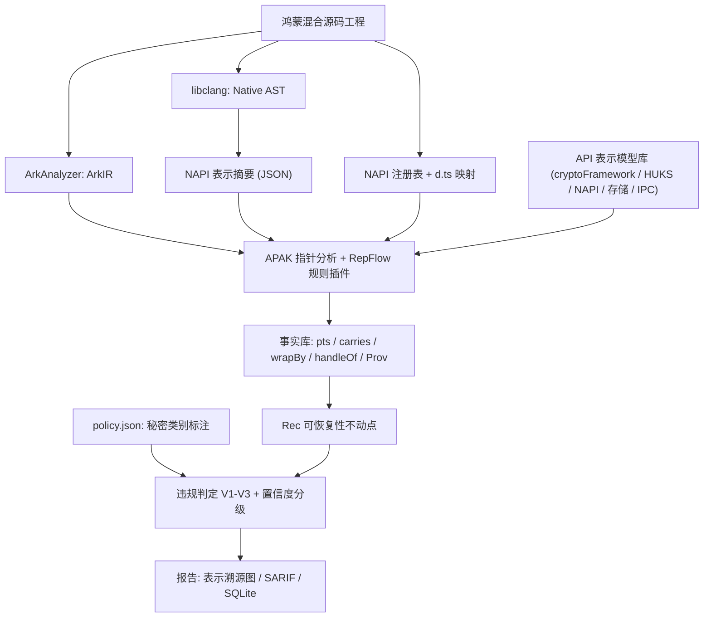

# 鸿钥卫士 KeyScope-HM v3.0 —— 开发总文档

**全称**：鸿钥卫士 KeyScope-HM —— 面向 HarmonyOS 混合应用的**跨运行时密钥表示与暴露风险分析系统**
**赛道**：2026 第五届"华秦杯"网络安全创新大赛 · 创意作品赛（方向：密码应用 / 密钥管理 / 密码算法实现）

> [!IMPORTANT]
> **v3 的一句话变化**：分析单位从"变量上的五维属性"改为"**逻辑密钥 κ 及其物理表示对象 ρ**"。每个表示对象的属性在创建点就固定下来，不再在汇合点做逐维合并，因此从结构上避免了身份丢失和不可能的状态组合。

---

## 第 0 章 对 v2 评审意见的处理

| 评审意见 | 处理 | 说明 |
|---|---|---|
| JScamd（USENIX Security 2026）使"密码 API + 污点 + LLM 规则"失去独占性 | **接受** | 已核实：322 个 JS 项目、16 条密码安全约束、精确率 97.78%、41 个 CVE。v3 不再主张这一组合是创新，并把 JScamd 风格的规则作为基线 B2 |
| 角色、保护状态不应是全序 | **接受** | 角色改为对象**类型**（材料、句柄、包装、单向派生），保护状态由表示对象的 form + container 决定，不再排序 |
| `ref: a.ref ?? b.ref` 丢失身份 | **接受** | 改为指向分析的对象集合（points-to set） |
| 逐维 join 会组合出不可能出现的状态 | **接受，并从结构上解决** | 属性固定在表示对象的创建点，汇合时只对**对象集合取并**，不对属性逐维合并 |
| 格高度与终止性论证不完整 | **部分接受** | 按链上的边数算，18 本身没错（按元素数算是 19）；但确实没有证明单调性。v3 改为 Datalog 式的单调事实推导，终止性来自有限事实空间（5.6 节） |
| `nodes[work.shift()]` 假设编号等于下标 | **接受** | 改用 Map |
| M1 不能等同于"已泄露" | **接受** | M1 改称 V1："可恢复的密钥表示进入不可按需清零的托管字符串，扩大了潜在明文驻留范围" |
| "落盘即破坏前向安全"过于绝对 | **接受** | 改称 V2："临时秘密以可恢复形式越过策略允许的生命周期 / 存储边界"；前向安全只作为动机说明 |
| 模拟器 HUKS ≠ 真实硬件隔离 | **接受** | HUKS 内部安全性作为**假设**，不作为验证对象 |
| 删除 M6，聚焦主线 | **接受** | M6、LLM 契约、IDE 一键修复全部移出核心，只在"未来工作"中出现一句 |

**我补充核实的关键事实**：ArkAnalyzer 已经提供 **APAK（ArkAnalyzer Pointer Analysis Kit）**，即面向 ArkTS 的上下文敏感指针分析，带有 ArkTS 堆对象模型和插件机制【需看源码确认插件接口】。v3 的表示对象可以作为**自定义堆对象**注入 APAK，不必从零写指针分析。这是 v3 能在 10 天内落地的关键前提，也是第一个成败关口。

---

## 第 1 章 立项意义（精简）

1. **产业事实**：HarmonyOS NEXT 不兼容 APK，应用必须用 ArkTS 重写，大量既有 C/C++ 密码代码通过 NAPI 复用。官方 Crypto Architecture Kit 支持用 `getEncoded()` 取出密钥字节，开发者 FAQ 中也有把对称密钥转成十六进制字符串的用法【附原文链接】。密钥在 ArkTS、NAPI、Native、HUKS 之间变换表示形式，是真实存在的开发模式。
2. **工具空缺**：
   - HarmoBridge（ASE 2025）解决了跨语言数据流连通；
   - HapCheck（ICSE 2026 SEIP）解决了 ArkTS 规则化缺陷检测；
   - JScamd（USENIX Sec 2026）解决了 JS 生态的密码 API 参数误用；
   - **还没有工作回答**：同一份密码学秘密跨越语言、运行时和存储之后，**产生了哪些可恢复的副本、它们落在哪里、是否违反该秘密的生命周期策略**。
3. **为什么系统层解决不了**：这些 API 都是合法的；底层只看到字节，看不到"这是哪一个秘密的第几份副本"。只能靠应用层的程序分析。

---

## 第 2 章 研究命题与边界

### 2.1 核心命题

> 当密码学秘密从 HUKS、Native C/C++ 或 ArkTS 密码接口流出，并经过复制、编码、包装、传输和持久化时，如何**识别同一逻辑密钥的全部表示**，判断每个表示**能否被还原为原始秘密**，并检测其是否进入了该秘密的安全策略所**不允许的域**？

### 2.2 三项贡献

| 编号 | 贡献 | 一句话 |
|---|---|---|
| C1 | **LSR 模型**（逻辑秘密—表示对象模型，Logical-Secret / Representation） | 把秘密身份、句柄、原始材料、可逆编码、加密包装、单向派生区分为不同的表示类型，并用"拷贝 / 别名 / 编码 / 包装"边连成表示溯源图 |
| C2 | **RepFlow 跨运行时表示传播算法** | 在 APAK 的上下文敏感指针分析上扩展表示对象，并为 NAPI 边界的拷贝和别名语义建立规则；以**可恢复性不动点**处理包装密钥 |
| C3 | **按秘密区分的生命周期策略违规判定 + 差分基准** | 针对每个 κ 的生命周期类别判定违规；用 HarmonyKeyRepBench 的成对样本和消融实验证明各组成部分的独立增益 |

### 2.3 与已有工作的边界

| 工作 | 它做了什么 | 我们复用 / 不主张 | 我们新增 |
|---|---|---|---|
| ArkAnalyzer + APAK | ArkIR、上下文敏感指针分析、调用图 | 复用为底座 | 表示对象和 NAPI 边界规则 |
| HarmoBridge | 跨语言数据流摘要（SumIR） | 不主张跨语言连通；借鉴摘要思想；用 CrossFlowBench 验证连通性 | 摘要中携带**拷贝 / 别名 / 编码**语义 |
| HapCheck | DSL 规则化缺陷检测 | 不主张规则化检测 | 秘密身份层面的推理 |
| JScamd | JS 密码 API 约束 + LLM 规则 + 污点 | 不主张"密码 API + 污点 + LLM"；作为基线 B2 | 关注**秘密表示与去向**，而非 API 参数是否合规 |
| CryptoGuard、CrySL | Java 密码误用 | — | — |

> [!NOTE]
> **必须完成的调研动作**：精读 JScamd、HarmoBridge、APAK 三篇论文的算法与实验部分，并看开源代码。如果发现其中某项已能处理"包装密钥可恢复性""拷贝 / 别名区分""按秘密区分的策略"中的大部分，就进一步缩小命题，并在文档中如实写明。

---

## 第 3 章 威胁模型与安全策略

### 3.1 攻击域

| 域 D | 攻击者能力 | 说明 |
|---|---|---|
| D_mem | 获取应用进程内存快照（调试接口、root、崩溃转储、同进程恶意 SDK） | 不可按需清零的表示在此域中风险最高 |
| D_store | 读取应用沙箱持久化文件（root、备份、设备丢失后取证） | 沙箱与分区加密属于纵深防御的一层，不作为保密假设 |
| D_ipc | 观察或接收跨应用传输（隐式 Want、被冒充的目标组件） | 显式 Want 的风险较低，降级报告 |
| D_log | 读取 hilog / 上传的崩溃日志 | — |

**假设**：HUKS / TEE 内部是安全的（不验证，且明确说明模拟器的 HUKS 不等于硬件隔离）；不考虑侧信道和内核漏洞。

### 3.2 秘密的生命周期类别与策略

每个逻辑秘密 κ 有类别 cls(κ)，默认由引入点推断，可用 `policy.json` 覆盖：

| cls(κ) | 默认推断来源 | 允许出现可恢复表示的位置 | 违规 |
|---|---|---|---|
| **Session / Ephemeral** | ECDH / HKDF / 协商派生；`generateRandom` 产生后只用于单次加密 | NativeHeap、ArkBuffer、ArkKeyObj（都可清零或由框架持有） | **V1**：出现在 ArkString；**V2**：出现在 Storage / IPC；**V3**：出现在 Log |
| **LongTerm-App** | `generateSymKey` 之后被持久化使用 | 同上；Storage 中只允许 **由 HUKS 密钥包装** 的形式 | V1（降级为 Medium）、V2（没有包装就落盘）、V3 |
| **HardwareBound** | `huks.generateKeyItem` | 只能在 HUKS 内部；应用层只应持有句柄 | 应用层任何可恢复表示（意味着被导出） |

> [!NOTE]
> 类别推断属于启发式。凡是依赖推断（而不是用户显式标注）的告警，置信度最高只到 Medium（见 5.5 节）。这样做是诚实的，也给评委留下"策略可配置"的工程空间。

---

## 第 4 章 LSR 模型（贡献 C1）

### 4.1 基本集合

- **抽象堆对象** H = Site × Ctx（创建点 × 上下文，上下文取 1-call-site 或 1-object，用于 APAK 已支持的策略）。
- **逻辑秘密** 𝒦 ⊆ H：在**秘密引入点**创建，例如 `generateSymKey`、`convertKey(raw)`、`HKDF`/`ECDH` 派生、`RAND_bytes` 写入密钥缓冲区、作为密钥参数使用的字面量、`huks.generateKeyItem`（κ 的"家"在 HUKS 内部）。
- **表示对象** ℛ ⊆ H，每个 ρ 带两个**在创建点就确定、此后不变**的属性：
  - **form(ρ)** ∈ { Raw, Enc⟨hex | b64 | utf8 | latin1⟩, KeyObj, Handle, Wrapped, OneWay }
  - **container(ρ)** ∈ { NativeHeap, ArkBuffer, ArkString, ArkKeyObj, Storage, IPC, Log, HUKS }

### 4.2 关系（分析过程中单调增长）

| 关系 | 含义 |
|---|---|
| pts(v, c) ⊆ H | 变量在上下文 c 下可能指向的对象（APAK 提供并扩展） |
| fld(h, f) ⊆ H | 对象字段指向（APAK 提供） |
| **carries(ρ) ⊆ 𝒦** | ρ 承载了哪些逻辑秘密 |
| **wrapBy(ρ) ⊆ 𝒦** | 对 Wrapped 表示，记录其包装密钥 |
| **handleOf(ρ) ⊆ 𝒦** | 对 Handle 表示，记录其指向的 HUKS 秘密 |
| **Prov ⊆ ℛ × Op × ℛ** | 表示溯源边，Op ∈ { copy, alias, encode, decode, wrap, unwrap, persist, send, log, napi } |

### 4.3 为什么这个模型能解决 v2 的三个问题

1. **分支 `x = keyA / keyB`**：pts(x) = {ρ_A, ρ_B}，两个对象各自保留 carries，**身份不丢失**。
2. **不可能的状态组合**：form 和 container 是对象自身固定不变的属性，汇合点只对**对象集合**取并，不存在"把 A 的角色和 B 的保护状态拼在一起"的情况。
3. **副本 vs 别名**：每次拷贝、编码、持久化都**新建**表示对象；别名（如 `napi_create_external_arraybuffer`）**复用同一个对象**。于是"有几份副本、各在哪里"可以直接查询。

### 4.4 可恢复性（核心判定谓词）

定义 Rec(κ, D) 为"攻击者在域 D 中能恢复秘密 κ"，取下面规则的**最小不动点**：

$$
\mathrm{Rec}(\kappa,D) \Leftarrow \exists \rho:\ \kappa\in\mathrm{carries}(\rho)\ \wedge\ \mathrm{dom}(\rho)\subseteq D\ \wedge\ \mathrm{form}(\rho)\in\{\mathrm{Raw},\mathrm{Enc},\mathrm{KeyObj}^{exp}\}
$$

$$
\mathrm{Rec}(\kappa,D) \Leftarrow \exists \rho:\ \kappa\in\mathrm{carries}(\rho)\ \wedge\ \mathrm{dom}(\rho)\subseteq D\ \wedge\ \mathrm{form}(\rho)=\mathrm{Wrapped}\ \wedge\ \exists \kappa'\in\mathrm{wrapBy}(\rho):\ \mathrm{Rec}(\kappa',D)
$$

- Handle 和 OneWay **永远不可恢复**；HardwareBound 秘密在应用层不可恢复（基于 HUKS 假设）。
- dom(ρ) 由 container 映射到攻击域：ArkString → D_mem，Storage → D_store，以此类推。
- 规则只含正递归，是**可分层的 Datalog**，最小不动点存在且有限步可达。
- **它能抓到的典型问题**：包装后的会话密钥和明文 KEK 存在同一个 Preferences 里。污点分析要么把 wrap 当净化器而漏报，要么不当净化器而在"用 HUKS 包装"的安全版上误报。


---

## 第 5 章 RepFlow 算法（贡献 C2）

### 5.1 整体思路

在 APAK 指针分析的约束求解过程中，把**密码 / NAPI / 存储 API 调用点**建模为"表示对象的创建点"，并同步推导 carries、wrapBy、handleOf、Prov 四个关系。全部规则都**只添加事实**（单调），最后在不动点上求 Rec 并判定违规。

### 5.2 ArkTS 侧规则（节选）

| 调用 | 产生的事实 |
|---|---|
| `g.generateSymKey()` 在点 s | 新建 κ_s；新建 ρ_s（KeyObj, ArkKeyObj），carries(ρ_s) = {κ_s} |
| `k.getEncoded()` 在点 s | 新建 ρ_s（Raw, ArkBuffer），carries ⊇ carries(pts(k))，Prov: copy |
| `Base64Helper.encodeToString*`、自定义 hex 函数、`TextDecoder.decode`、`String.fromCharCode`、`JSON.stringify` | 新建 ρ（Enc, ArkString），carries ⊇ carries(arg)，Prov: encode |
| `Base64Helper.decodeSync`、`new Uint8Array(src)`、`slice` | 新建 ρ（Raw, ArkBuffer），Prov: decode / copy |
| `huks.generateKeyItem(alias, …)` | 新建 κ_h（HardwareBound）；alias 指向的字符串对象被标记为 Handle 表示，handleOf ⊇ {κ_h} |
| `huks.wrapKey` 或模型库中的包装函数 | 新建 ρ（Wrapped），carries ⊇ carries(被包装的密钥)，wrapBy ⊇ 包装密钥所承载的秘密 |
| `cryptoFramework.createMd(...).digest`、HMAC 输出 | 新建 ρ（OneWay），carries = ∅（不可恢复） |
| HKDF / PBKDF2 / ECDH 输出 | **新秘密** κ'（Session），Prov 记录派生来源 |
| `preferences.put(k, v)`、`fs.write`、`relationalStore.insert` | 新建 ρ（form 继承 v 的表示形式, Storage），Prov: persist |
| `want.parameters[k] = v`、`startAbility`、`rpc.MessageSequence.write*` | 新建 ρ（继承形式, IPC），Prov: send；隐式 Want 加标记 |
| `hilog.*`、`console.*` | 新建 ρ（Enc, Log），Prov: log |

### 5.3 NAPI 边界规则（拷贝与别名，跨语言的核心）

| Native 调用 | 语义 | 事实 |
|---|---|---|
| `napi_create_string_utf8/latin1/utf16(buf)` | **拷贝**到托管字符串 | 新建 ρ（Enc⟨utf8⟩ 或 Raw-in-string, ArkString）；carries ⊇ carries(buf) |
| `napi_create_buffer_copy`、`napi_create_arraybuffer` + `memcpy` | **拷贝** | 新建 ρ（Raw, ArkBuffer）；**原 Native 缓冲区仍然独立存在** |
| `napi_create_external_arraybuffer(buf)` | **别名**（共享内存） | 不新建对象：ArkTS 返回值直接指向 ρ_buf，并把 ρ_buf 标记为跨运行时共享 |
| `napi_get_arraybuffer_info(arr, &p)` | **别名** | p 指向 arr 的同一表示对象 |
| `napi_get_value_string_utf8(str, buf)` | **拷贝**回 Native | 新建 ρ（Raw, NativeHeap） |
| `napi_get_cb_info` → argv[i] | 参数绑定 | 把 ArkTS 调用点的第 i 个实参的 pts 传给 argv[i] |

Native 侧由摘要器（libclang）为每个 NAPI 导出函数生成**表示摘要**：入参 → 返回值的表示变换（拷贝 / 别名 / 编码）、内部新建的秘密、调用了哪些清零函数。ArkTS 侧遇到 Native 调用时，**把摘要实例化为上述事实**。

### 5.4 上下文敏感：防止共用的辅助函数把身份混在一起

`toHex()` 同时被用于公开 IV 和密钥时，如果只按创建点建对象，两者会落到同一个 ρ 上，IV 也会"携带"密钥 κ。处理方法是：

- 对**表示转换辅助函数**（模型库中的函数，加上"入参是字节、返回字符串"的启发式识别）使用 **1-call-site 堆克隆**；
- 消融实验 −Ctx 专门验证这一点（基准 F6）。

### 5.5 违规判定与置信度分级

违规见证 = (κ, ρ, V_i, 溯源路径 π)：κ ∈ carries(ρ)，Rec(κ, dom(ρ)) 成立，且 dom(ρ) 不在 cls(κ) 的允许集合内。

| 等级 | 条件 |
|---|---|
| **High** | π 上每一跳的 pts 解析结果都是单元素集合；没有未知摘要；cls(κ) 来自用户标注或无歧义的引入点（如 ECDH 派生） |
| **Medium** | π 上存在多元素 pts（可能别名）；或 cls(κ) 来自启发式推断 |
| **Uncertain** | π 经过未知 Native 摘要、反射 / 动态属性，或 .hap 反编译缺口 |

> [!NOTE]
> 这里**不声称"must 分析"**：静态分析证明不了路径一定可达。分级依据的是"**指向集合的纯度 + 证据来源**"，含义清晰，评委问起也能讲清楚。

### 5.6 正确性论证（答辩用）

- **单调性**：所有规则都形如"前提事实 ⇒ 新事实"，不删除、不取反（Rec 只含正递归）→ 推导算子单调。
- **终止性**：在上下文深度有界时，H、𝒦、Op 都是有限集合，所有关系都是有限全集的子集，构成有限幂集格。单调算子在有限格上经有限步到达最小不动点（Knaster–Tarski + 有限高度）。
- **Soundy 边界（如实列出）**：反射与动态属性名、未建模 API、Native 函数指针 / 动态注册、`eval`。每类在报告中统计数量，路径经过它们的告警标为 Uncertain。
- **流不敏感的代价**：堆是流不敏感的（APAK 默认），所以对"先 `fill(0)` 再使用"这类时序性质不做判定。清零属于扩展模块 E1，单独用流敏感的 must 分析处理。

### 5.7 扩展模块（不进入核心创新，按时间推进）

- **E1 清零与 M4**：对 Native / ArkBuffer 表示做流敏感 must 清零分析；利用拷贝 / 别名语义判断"清零了别名就等于清零了原件，清零了副本不等于清零了原件"；`-O0` / `-O2` 反汇编实验。
- **E2 GCM Nonce 复用**（原 M3）。
- **E3 HUKS 导入前暴露**（原 M2）：在溯源图上查询 importKeyItem 实参的上游路径中是否存在 Log / Storage 表示。

---

## 第 6 章 系统架构



"硬件框图"一节写部署与验证环境：分析工作站、DevEco 模拟器（可选真机）、OHOS NDK 工具链、SQLite。

**工程结构**：
```
keyscope-hm/
├─ core-ts/           # APAK 插件：repr.ts, rules/, rec.ts, check.ts, grade.ts
├─ models/            # API 表示模型 (JSON)：arkts_crypto, huks, napi, storage, ipc
├─ native-py/         # libclang NAPI 摘要器
├─ bench/             # HarmonyKeyRepBench（每对可编译为 .hap）
├─ baselines/         # B0 正则熵 / B1 同底座污点 / B2 B1+JScamd 式约束
├─ eval/              # 消融、指标、标注表、κ 一致性
├─ realworld/         # 采集、commit 锁定、扫描结果库
└─ dynamic/           # 堆快照辅助实验
```


---

## 第 7 章 测试与验证方案（贡献 C3）

### 7.1 HarmonyKeyRepBench：按"能力"设计的成对差分基准

每一组都是**只差一处关键语义**的 A/B 程序，并且都能编译成 .hap 运行。

| 组 | A（期望不报） | B（期望报） | 检验的能力 | 预计哪个基线会失败 |
|---|---|---|---|---|
| F1 句柄 vs 材料 | HUKS 别名写入 Preferences | `getEncoded()` → Base64 → 写入 Preferences | 同样是字符串，区分句柄和材料 | B0 |
| F2 NAPI 拷贝形式 | `napi_create_buffer_copy` 返回、只在内存中使用 | `napi_create_string_utf8(hex(buf))` 返回 | 跨语言表示转换参与判定 | 不建 NAPI 模型的 ArkTS-only 版本 |
| F3 包装可恢复性 | 会话密钥用 HUKS 密钥包装后存储 | 用明文 KEK 包装，KEK 存在同一个 Preferences | Rec 不动点 | B1、B2（把 wrap 当净化器 → 漏报；不当 → 在 A 上误报） |
| F4 按秘密区分的策略 | 分支选中长期密钥，经 HUKS 包装后存储 | 同一变量在另一分支上是会话密钥，明文存储 | 身份保留 + 按 κ 套用策略 | B1（单一污点标签） |
| F5 共用辅助函数 | `toHex(iv)` 写入日志（IV 是公开参数） | `toHex(key)` 写入日志 | 上下文敏感 | −Ctx 消融 |
| F6 单向派生 | 密钥的 SHA-256 摘要被存储 | 密钥的 Base64 被存储 | OneWay 不可恢复 | B1 |
| F7 结构体 / 序列化 | 对象中只有别名字段，`JSON.stringify` 后存储 | 对象中含密钥字节字段，`JSON.stringify` 后存储 | 字段敏感 + 编码 | B0 |
| F8（扩展 E1）拷贝 vs 别名清零 | external arraybuffer 上 `fill(0)`（清零了原件） | buffer_copy 上 `fill(0)`，Native 原件未清零 | 拷贝 / 别名语义 | 所有不区分拷贝和别名的方法 |

**规模**：8 组 × 每组 3–4 种变体（多层封装、异步回调、类字段中转、分支）× 2 ≈ 50–60 个程序。**开源发布**。

### 7.2 基线与消融（同一底座、同一模型库，保证公平）

| 方法 | 说明 |
|---|---|
| B0 | 正则 + 信息熵 + 变量命名 |
| B1 | APAK 底座上的二元污点：source 为密钥材料 API，sink 为 String / 存储 / IPC / 日志 |
| B2 | B1 + JScamd 式密码约束规则（按论文复现可移植到 ArkTS 的约束子集；若 JScamd 开源且能处理转译后的代码，则直接运行并注明） |
| −Identity | 去掉 κ 身份（退化为单一的"秘密"标签） |
| −CopyAlias | NAPI 规则统一当作拷贝或统一当作别名 |
| −Ctx | 辅助函数不做堆克隆 |
| −Rec | Wrapped 一律视为安全 |
| −Handle | 不建句柄模型（别名字符串视为普通数据） |
| KeyScope-HM | 完整版 |

**指标**：Precision、Recall、F1、误报率（A 组）、各消融相对完整版的 ΔF1、分析耗时（中位数 / P95）、Uncertain 占比。**所有数字一律实测后填入。**

> [!IMPORTANT]
> 要诚实写明：在简单样本上 B1 / B2 可能和完整版一样好。v3 的增益**只应出现在**身份、拷贝 / 别名、包装、上下文这几类样本上，这正是消融要证明的。如果实测没有增益，就收缩主张，而不是改数据。

### 7.3 连通性验证

用 HarmoBridge 的 **CrossFlowBench**（如可获取）测 NAPI 桥接的连通召回，证明底座没有短板。这一项不作为创新点。

### 7.4 真实项目

- **采集**：Gitee（OpenHarmony 官方 / SIG）、GitCode、GitHub、ohpm 三方库中调用 `@kit.CryptoArchitectureKit` / `cryptoFramework` / `huks` / NAPI 的项目，锁定 commit。纯 ArkTS 组和混合组分开统计。
- **标注**：两人独立标注 + Cohen's κ + 第三人仲裁；真实项目上**只报精确率**，并对每条 TP 写清"产生原因"（例如开发者把 hex 字符串当作方便传参的格式）。
- **负责任披露**：对确认的问题提交 issue 或 PR（隐去细节），记录维护者的回复。
- **数据库**：`projects`、`secrets(κ, site, cls, cls_source)`、`reprs(ρ, site, form, container, carries)`、`findings(κ, ρ, rule, grade, path_json, label, disclosed_url)`。

### 7.5 运行时辅助证据（只支撑 V1 的前提，不证明每条告警）

- 在模拟器中运行 F2-B 和 F2-A：Native **随机**生成密钥 → 返回 → 完成一次加密 → 置空引用 → 触发 GC → 抓 ArkTS 堆快照，按本次运行时的密钥值（hex 和原始字节）搜索；重复 N 次，统计残留率，并保留基线快照作对照。
- 措辞以实测为准；不用模拟器 HUKS 的行为推断真机硬件隔离。

### 7.6 结果表模板（实测填入）

| 方法 | P | R | F1 | A 组误报率 | F3 | F4 | F5 | 中位耗时 |
|---|---|---|---|---|---|---|---|---|
| B0 / B1 / B2 / 各消融 / 完整版 | — | — | — | — | — | — | — | — |

（F3–F5 列填写该组的通过对数 / 总对数。）

---

## 第 8 章 成败关口与时间表

### 8.1 三个关口（任何一个不过，就调整命题）

| 关口 | 截止 | 通过标准 | 不通过时的退路 |
|---|---|---|---|
| G1 底座可扩展 | 10/31 | 能在 APAK 中注入 API 调用点的自定义堆对象并读出 pts | 在 ArkIR 上自写 Andersen 子集（只覆盖赋值、调用、字段、返回） |
| G2 跨语言真实打通 | 11/03 | 真实 ArkTS → NAPI → C++ 路径中能恢复 κ 的来源、表示转换和去向（F2 通过） | 跨语言部分降级为"摘要手工补全 + 自动实例化"，并如实说明 |
| G3 算法有增益 | 11/05 | 在 F3 / F4 / F5 上，完整版相对 B1 / B2 有可重复的优势 | 收缩主张为"表示溯源 + 策略检查的工程化"，重写贡献表述 |

### 8.2 时间表

| 日期 | 工作 |
|---|---|
| 10/29–10/30 | 精读 JScamd / HarmoBridge / APAK 的算法与代码；跑通 APAK 示例；写 `repr.ts` 数据结构 |
| 10/31 | **G1**；ArkTS 侧规则（5.2 节）+ 模型库 v0 |
| 11/01–11/02 | Rec 不动点 + 违规判定 + 分级；F1、F3–F7 的 ArkTS 样本（并行编写） |
| 11/02–11/03 | libclang 摘要器 + NAPI 规则（5.3 节）+ F2；**G2** |
| 11/04–11/05 | B0 / B1 / B2 与消融实测；**G3** |
| 11/05–11/06 | 真实项目扫描与双人标注；堆快照实验 |
| 11/06–11/08 | 系统设计方案、测试方案、作品声明、复现 README |
| 11/09–11/21 | 披露跟进；扩展 E1（F8 + 反汇编）；演示打磨与彩排 |

---

## 第 9 章 答辩与演示（10 分钟）

| 时间 | 内容 |
|---|---|
| 0:00–1:00 | 问题：同样一个字符串，可能是 HUKS 别名，也可能是密钥的 Base64，为什么系统层分不清 |
| 1:00–2:30 | 模型：逻辑秘密 κ → 多个表示 ρ（一张溯源图） |
| 2:30–5:30 | **现场演示三连**：①F1 A/B：别名不报、编码后的密钥报；②F2：Native 经 NAPI 生成 hex 副本，证据链跨 C++ ↔ ArkTS；③F3：包装密钥与明文 KEK 同处一地 → Rec 成立 → 报警；换成 HUKS 包装 → 不报 |
| 5:30–7:00 | 消融表（突出 F3 / F4 / F5）+ 真实项目发现与披露情况 + 堆快照残留统计 |
| 7:00–10:00 | 提问 + 源码讲解路线：`repr.ts` → `rules/napi.ts` → `rec.ts` → `grade.ts` |

---

## 第 10 章 专家提问预案

| 问题 | 要点 |
|---|---|
| 和 JScamd 有什么区别？ | JScamd 检查 API 参数是否满足密码约束；我们追踪**同一个秘密的全部表示**及其可恢复性和去向，而且跨 ArkTS / NAPI / C++；JScamd 式规则就是我们的基线 B2 |
| 和污点分析本质上有什么不同？ | 污点是值上的标签；我们是**带身份的对象**加上**表示溯源图**，能区分拷贝和别名，能按秘密套用策略，并通过 Rec 处理包装。F3 / F4 是污点分析做不对的反例 |
| 不动点为什么一定终止？ | 规则只添加事实，Rec 只含正递归；有限幂集格 + 单调算子 |
| 怎么证明路径真的可达？ | 不声称；分级依据指向集合纯度和证据来源；运行时实验只用来支撑前提 |
| 秘密类别推断错了怎么办？ | 推断出来的类别最高只到 Medium；`policy.json` 可覆盖；基准里有专门标注的样本 |
| 模拟器的 HUKS 能代表真机吗？ | 不能，所以 HUKS 内部安全是我们的**假设**，不是我们的结论 |
| 字符串化就等于泄露吗？ | 不等于；V1 的定义是"可恢复表示进入不可按需清零的托管对象，扩大了潜在驻留范围" |

---

## 第 11 章 风险与对策

| 风险 | 对策 |
|---|---|
| APAK 插件接口不满足需求（G1） | 自写 Andersen 子集；范围控制在基准和真实项目用到的语句 |
| 已有工作覆盖了核心命题 | 调研后缩小到"包装可恢复性 + 拷贝 / 别名"两点，并在文档中写明 |
| 真实混合项目太少 | 纯 ArkTS 组作为主要实证；混合组如实报告样本数 |
| 真实 TP 很少 | 扩大到 ohpm 三方库；也报告"安全使用模式"的统计，同样有价值 |
| 时间不足 | 只保 V1 / V2 + F1–F7 + 消融；E1–E3 写成扩展设计 |

---

## 第 12 章 提交材料对照

| 官方要求 | 对应章节 |
|---|---|
| 系统设计方案 | 第 1–6 章（指标定义在 7.2 节；硬件框图写部署环境） |
| 系统测试方案 | 第 7 章 + 实测结果 |
| 其他文档 | 基准说明、复现 README、披露记录、模型库文档 |
| 作品声明 | 原创声明；开源依赖与许可证（ArkAnalyzer / APAK、libclang 等）；不涉密；漏洞已脱敏 |

---

## 附录 A 核心骨架代码（TypeScript）

```typescript
// core-ts/repr.ts —— LSR 模型：对象属性在创建点固定，关系单调增长
export type Form = 'Raw' | 'Enc' | 'KeyObj' | 'Handle' | 'Wrapped' | 'OneWay';
export type Container = 'NativeHeap' | 'ArkBuffer' | 'ArkString' | 'ArkKeyObj'
                      | 'Storage' | 'IPC' | 'Log' | 'HUKS';
export type Domain = 'D_mem' | 'D_store' | 'D_ipc' | 'D_log' | 'D_safe';
export type SecretClass = 'Session' | 'LongTerm' | 'HardwareBound';

export interface Secret { id: string; site: string; cls: SecretClass; clsFromUser: boolean; }
export interface Repr {
  id: string; site: string; ctx: string;
  readonly form: Form; readonly container: Container;   // 创建时固定，不参与合并
}
export type Op = 'copy' | 'alias' | 'encode' | 'decode' | 'wrap' | 'persist' | 'send' | 'log' | 'napi';

export function domOf(c: Container): Domain {
  switch (c) {
    case 'ArkString': return 'D_mem';      // 不可按需清零
    case 'Storage':   return 'D_store';
    case 'IPC':       return 'D_ipc';
    case 'Log':       return 'D_log';
    default:          return 'D_safe';     // NativeHeap/ArkBuffer/ArkKeyObj/HUKS：可清零或受框架控制
  }
}

/** 单调事实库：只增不删 */
export class Facts {
  secrets = new Map<string, Secret>();
  reprs = new Map<string, Repr>();
  carries = new Map<string, Set<string>>();   // ρ -> {κ}
  wrapBy = new Map<string, Set<string>>();    // ρ -> {κ'}
  handleOf = new Map<string, Set<string>>();  // ρ -> {κ}
  prov: Array<[string, Op, string]> = [];
  changed = false;

  private add(m: Map<string, Set<string>>, k: string, vs: Iterable<string>) {
    const s = m.get(k) ?? new Set<string>(); const before = s.size;
    for (const v of vs) s.add(v);
    m.set(k, s); if (s.size !== before) this.changed = true;
  }
  addCarries(r: string, ks: Iterable<string>) { this.add(this.carries, r, ks); }
  addWrapBy(r: string, ks: Iterable<string>) { this.add(this.wrapBy, r, ks); }
  addHandle(r: string, ks: Iterable<string>) { this.add(this.handleOf, r, ks); }
}
```

```typescript
// core-ts/rules/transfer.ts —— 调用点规则（由 APAK 插件在解析调用时触发）
import { Facts, Form, Container, Op } from '../repr';

/** 拷贝 / 编码类转换：新建表示对象，carries 继承自源对象集合 */
export function convert(f: Facts, site: string, ctx: string, srcPts: Set<string>,
                        form: Form, container: Container, op: Op): string {
  const id = `${site}@${ctx}`;
  if (!f.reprs.has(id)) { f.reprs.set(id, { id, site, ctx, form, container }); f.changed = true; }
  for (const s of srcPts) {
    const ks = f.carries.get(s); if (ks) f.addCarries(id, ks);
    f.prov.push([s, op, id]);
  }
  return id;            // 调用者把返回值变量的 pts 设为 {id}
}

/** 别名（如 napi_create_external_arraybuffer）：不新建对象，直接复用源对象集合 */
export const alias = (srcPts: Set<string>) => new Set(srcPts);

/** 包装：carries 来自被包装的密钥，wrapBy 来自包装密钥 */
export function wrap(f: Facts, site: string, ctx: string, keyPts: Set<string>,
                     kekPts: Set<string>, container: Container): string {
  const id = convert(f, site, ctx, keyPts, 'Wrapped', container, 'wrap');
  for (const k of kekPts) { const ks = f.carries.get(k); if (ks) f.addWrapBy(id, ks); }
  return id;
}

/** 单向派生（摘要 / MAC）：不承载可恢复秘密 */
export function oneWay(f: Facts, site: string, ctx: string, container: Container): string {
  const id = `${site}@${ctx}`;
  if (!f.reprs.has(id)) { f.reprs.set(id, { id, site, ctx, form: 'OneWay', container }); f.changed = true; }
  return id;
}
```

```typescript
// core-ts/rec.ts —— 可恢复性最小不动点 + 违规判定
import { Facts, Domain, domOf, SecretClass } from './repr';

const RECOVERABLE = new Set(['Raw', 'Enc', 'KeyObj']);

export function computeRec(f: Facts): Set<string> {          // 元素形如 "κ|D"
  const rec = new Set<string>();
  let changed = true;
  while (changed) {                                           // 有限集合上的单调迭代 -> 终止
    changed = false;
    for (const r of f.reprs.values()) {
      const D = domOf(r.container); if (D === 'D_safe') continue;
      const ks = f.carries.get(r.id); if (!ks) continue;
      let ok = RECOVERABLE.has(r.form);
      if (!ok && r.form === 'Wrapped') {
        const keks = f.wrapBy.get(r.id) ?? new Set<string>();
        ok = [...keks].some(k => rec.has(`${k}|${D}`) &&
                                  f.secrets.get(k)?.cls !== 'HardwareBound');
      }
      if (!ok) continue;
      for (const k of ks) {
        if (f.secrets.get(k)?.cls === 'HardwareBound') continue;   // HUKS 假设
        const key = `${k}|${D}`;
        if (!rec.has(key)) { rec.add(key); changed = true; }
      }
    }
  }
  return rec;
}

const FORBIDDEN: Record<SecretClass, Domain[]> = {
  Session:       ['D_mem', 'D_store', 'D_ipc', 'D_log'],
  LongTerm:      ['D_mem', 'D_store', 'D_ipc', 'D_log'],   // D_mem 判为 Medium
  HardwareBound: ['D_mem', 'D_store', 'D_ipc', 'D_log'],
};
const RULE: Record<Domain, string> = { D_mem: 'V1', D_store: 'V2', D_ipc: 'V2', D_log: 'V3', D_safe: '-' };

export function check(f: Facts, rec: Set<string>) {
  const out: Array<{ secret: string; domain: Domain; rule: string }> = [];
  for (const item of rec) {
    const [k, D] = item.split('|') as [string, Domain];
    const s = f.secrets.get(k); if (!s) continue;
    if (FORBIDDEN[s.cls].includes(D)) out.push({ secret: k, domain: D, rule: RULE[D] });
  }
  return out;   // 再交给 grade.ts：按溯源路径上的 pts 纯度、摘要状态、cls 来源分级
}
```

---

## 附录 B 引用核实状态

| 引用 | 状态 |
|---|---|
| JScamd（USENIX Security 2026：322 个项目、16 条约束、97.78%、41 个 CVE） | 已核实（检索摘要），引用前对照原文 |
| HarmoBridge / SumIR / CrossFlowBench（ASE 2025） | 已核实 |
| HapCheck（ICSE 2026 SEIP，北航 + 华为） | 已核实 |
| ArkAnalyzer + APAK 上下文敏感指针分析 | 已核实存在；**插件接口待看源码确认（G1）** |
| Crypto Architecture Kit 的 `getEncoded` / 十六进制转换 FAQ | 待附官方链接 |
| security_huks 开源仓关于模拟实现与硬件环境差异的说明 | 待附原文链接 |
| CWE-316 / 226 / 312 / 927 / 532 / 14 | 标准条目，附 MITRE 链接 |
